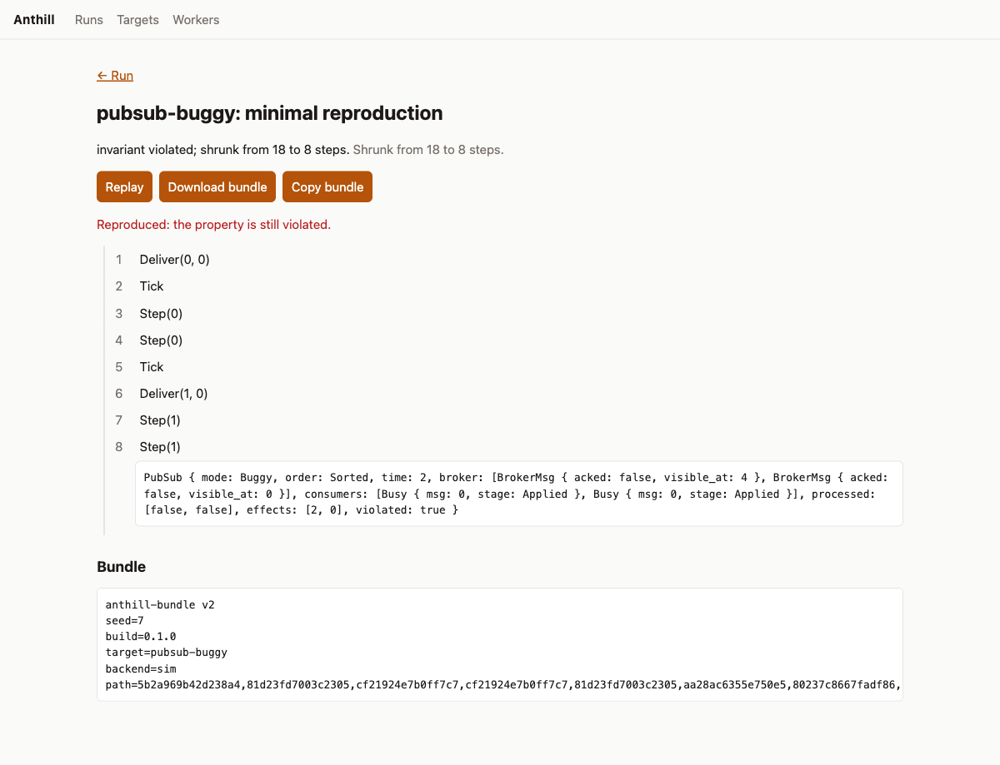

<h1 align="center">Hairspring</h1>
<p align="center"><strong>Deterministic simulation testing you can run on your laptop and your own servers.</strong></p>
<p align="center">
  
  
  
</p>

Hairspring explores many executions of a system, finds the rare interleaving or fault sequence that breaks a
property, **shrinks it to a minimal trace, and hands you a bundle that replays it exactly**. It is inspired by
the deterministic-simulation testing used by FoundationDB and TigerBeetle. It is open source and runs on your
laptop or your own servers.

<p align="center"></p>

```text
$ hairspring test pubsub-buggy --seed 5
hairspring: exploring pubsub-buggy (seed 5)
FAILED  pubsub-buggy (sim)
  invariant violated; shrunk from 23 to 8 steps
  steps (8):
      1. Deliver(1, 0)
      2. Tick
      3. Tick
      4. Deliver(0, 0)
      5. Step(1)
      6. Step(0)
      7. Step(1)
      8. Step(0)
  bundle written: .hairspring/bundles/pubsub-buggy-d3858727.hairspring  (replay with `hairspring replay .hairspring/bundles/pubsub-buggy-d3858727.hairspring`)
$ hairspring replay .hairspring/bundles/pubsub-buggy-d3858727.hairspring   # exits 1 while the bug exists
```

## What you get

| | |
|---|---|
| **Find** | Seeded exploration with snapshot-and-branch (about 3.5x fewer steps than restarting from scratch on the demo targets; your system will differ) |
| **Shrink** | Delta-debugging to a 1-minimal trace that preserves the *same* failure |
| **Replay** | One-file text bundles; replay is exact, checked against the program version |
| **Check determinism** | `hairspring doctor` runs the same seed twice and reports the first divergence |
| **Use it from anywhere** | CLI, REST + live events, web UI, **MCP server for AI agents**, GitHub Action, Claude Code plugin |
| **Scale out** | SQLite locally; PostgreSQL + remote workers for teams; Docker Compose included |

## Backends: how much determinism do you get?

Determinism is a property of how a system is run, and it is hard. Hairspring is explicit about what each backend
gives you and where it runs. We measured these (see [docs/determinism.md](docs/determinism.md)).

| Backend | You provide | Determinism | macOS | Linux x86-64 | Status |
|---|---|---|---|---|---|
| **`sim`** | A state machine implementing the `Sim` trait (Rust) | Total: the state is plain data | Yes | Yes | Stable core |
| **`wasm`** | A WebAssembly module using `hairspring.choose/rand/fail` imports | Total for the guest (NaN canonicalisation, fuel, memory limits); snapshot/fork of memory | Yes | Yes | Working |
| **`process`** | An unmodified Linux program (threads, sockets) | Exploration by scheduler seed under [Hermit](https://github.com/rrnewton/hermit); failures reproduce exactly | **No** | **Yes** (bare metal or PMU-capable VM) | Experimental |

Measured on real hardware: a WASM trace hash recorded on macOS arm64 is identical on Linux x86-64; the
Hermit backend found a real check-then-act threading bug in a C program, reproduced it 3/3 times, and
found a duplicate-delivery bug in an unmodified Python Dapr consumer through a simulated sidecar.

To install Hermit and try the `process` backend on a suitable Linux machine, see
[docs/quickstart.md](docs/quickstart.md); `hairspring doctor --process-backend` reports whether a machine can run it.

What we do **not** claim: bit-exact replay of arbitrary programs on macOS (there is no supported way to do
this), a general-purpose deterministic hypervisor, or that Hermit (a young open-source
project) is production-hardened. See [Limitations](#limitations).

## Quick start

```bash
git clone https://github.com/spiculedata/hairspring && cd hairspring
make ui                       # build the web UI (embedded into the server binary)
cargo build --release -p hairspring-cli
export PATH="$PWD/target/release:$PATH"

hairspring targets               # built-in demos
hairspring test lock-lease --seed 7
hairspring doctor lock-lease     # is the target deterministic?
hairspring serve                 # REST API, live UI and MCP at http://127.0.0.1:7878
```

Without `make ui` the server still works (API and MCP); it shows a placeholder page instead of the UI.
`scripts/install.sh` builds the CLI and installs it to `~/.local/bin` (or, with `--version <tag>`, downloads a release
binary and verifies its sha256 first), then runs `hairspring doctor`.

### Test your own system

Write a state machine (see [`crates/hairspring-core/src/sim.rs`](crates/hairspring-core/src/sim.rs) and the worked
example in [`crates/hairspring-pubsub`](crates/hairspring-pubsub)):

```rust
impl Sim for MySystem {
    type Action = Action;                       // Copy + Debug
    fn enabled(&self) -> Vec<Action>;           // what could happen next (deterministic order)
    fn action_id(a: &Action) -> ActionId;       // a STABLE id, never a list index
    fn apply(&self, a: Action) -> Self;         // pure: returns the next state
    fn signature(&self) -> u64;                 // abstract state, steers exploration
    fn violated(&self) -> bool;                 // the property
}
```

Register it in your own binary and you get the whole CLI, server, UI and MCP for it:

```rust
fn main() -> std::process::ExitCode {
    hairspring_cli::main_with(hairspring_engine::erased::Registry::new().with("my-system", "what it does", MySystem::new))
}
```

Or test a real program without modelling it, in `hairspring.toml` (Linux):

```toml
[target.checkout]
kind = "process"
command = ["/opt/app/bin/checkout", "--self-test"]   # fails by exit code, or prints HAIRSPRING_VIOLATION: ...
trial_timeout_secs = 120
# Optional scheduling strategy; see `hairspring init` for the options (chaos, max_timeslice_ns, skid_margin, heuristic).
[target.checkout.budget]
max_trials = 100
```

A failing seed can be confirmed in recorded steps with `hairspring confirm <run-or-failure-id>`: same-seed reruns
compared on output, schedule and failing property, a bundle replay with its environment check, and optionally a
fixed-version control (`--control <target>`) and Hermit's strict determinism verify (`--strict-verify`). See
[docs/determinism.md](docs/determinism.md#confirming-a-failure). Only `process` targets can be confirmed: for a
simulation target the command stops with ``error: no backend available for target kind ``confirm` is not supported by
the sim backend` ``.

A trial that times out is reported as inconclusive, not as a pass or a failure, unless you set
`hang_is_violation = true`. Programs can also report assertions through the guest event protocol; see
[docs/guest-protocol.md](docs/guest-protocol.md), the C SDK in [`sdks/c`](sdks/c) ([docs/c-sdk.md](docs/c-sdk.md)) and
the Go SDK in [`sdks/go`](sdks/go), the Rust SDK in [`sdks/rust`](sdks/rust) ([docs/rust-sdk.md](docs/rust-sdk.md)) and
the Python SDK in [`sdks/python`](sdks/python) ([docs/python-sdk.md](docs/python-sdk.md)), the Java SDK in
[`sdks/java`](sdks/java) ([docs/java-sdk.md](docs/java-sdk.md)) and the .NET SDK in [`sdks/dotnet`](sdks/dotnet)
([docs/dotnet-sdk.md](docs/dotnet-sdk.md)). Which languages have passed our acceptance test under Hermit, and on what
configuration, is in [docs/support-matrix.md](docs/support-matrix.md).

### Measure a failure rate (sweep)

A normal run stops at its first confirmed failure. That finds a bug, but it cannot say how often the bug happens. A
sweep runs the whole trial budget past every failure and stores every trial:

```bash
hairspring test checkout --sweep --trials 1000 --seed 1   # trials at seeds 1 to 1000
hairspring test checkout --sweep --seeds 5000..5500       # seeds 5000 to 5499 (END is not run)
```

The report gives the violations out of the rated trials with a Wilson 95% interval (with no violation, an exact upper
bound instead), names the lowest failing seeds, and lists timeouts, trials with unusable output and trials that failed
in the host apart: they are never in the denominator and never counted as passes.

Up to the first ten violations are each confirmed by re-running their seed, and the trial's row says how many reruns
gave the same output (`same-output reruns k/n`). A confirmation is skipped, and the row says so, when the limit of ten
is reached, when the sweep is out of wall-clock budget, or when it was cancelled. The exit code is 1 when any trial was
a violation. `--trials` is at most 10,000, and a sweep also ends at `--budget-secs`. For a simulation target a trial is
one exploration round and the rounds share `--budget-steps`, so raise it to run more of them; a default simulation
sweep runs only a few rounds. The report says when a sweep ended before its trial budget, and why as far as the server
can tell.

Over HTTP, send `"mode": "sweep"` to `POST /api/runs`; over MCP, pass `mode` and `max_trials` to `start_run`. The
finished run's `sweep` field (in `GET /api/runs/{id}` and the MCP `get_run`) holds the counts and the first failing
seeds, counted by the server from the stored trials. It is left out for a search, for a run still going, and for a
sweep that is marked incomplete and holds fewer trials than its budget, whatever the reason (counts only, never a
rate); the per-property cells of such a report are property-level figures, not the sweep's rate. The comparison with
the budget uses the trials the server holds, not the count the worker reports. It is kept for a sweep that ran its whole budget even if the server had to replace some trial digests (its
property statistics are then incomplete, its verdict counts are not). `sweep_partial` is true
when the sweep ended in an error or was cancelled: its counts are those of whatever ran, so a client that states a rate
must check it and the run's state. REST and MCP accept a first seed near the top of the 64-bit range and wrap round
to 0, while the CLI refuses such a sweep. Without a mode a run is a search, as before.

## For AI agents (MCP)

`hairspring mcp` (stdio) or `POST /mcp` (HTTP) expose the loop an agent needs: `list_targets`, `start_run`,
`get_failure` (minimal trace plus plain-language explanation), `replay_bundle`, `get_failure_checks` (the stored
confirmation checks of a failure), `cancel_run`.

```bash
claude mcp add hairspring -- hairspring mcp
```

Everything that comes from the system under test (step labels, states, messages) is sanitised and framed
as **untrusted data** for the agent. See [`integrations/claude-code`](integrations/claude-code).

## Dapr services

[`hairspring-dapr`](crates/hairspring-dapr) is a simulated Dapr sidecar: state store with ETags and first-write
concurrency, publish, and at-least-once subscription delivery, with seeded duplicates, reordering, drops,
app crashes, state conflicts and errors. Run it as a `process` target and Hermit explores the schedules.
See [`examples/dapr-orders`](examples/dapr-orders). Implemented subset only: no bindings, secrets, actors,
workflows or gRPC.

## Run it for a team

```bash
# Put these in a .env file next to docker-compose.yml (tokens must be at least 16 characters):
#   HAIRSPRING_DB_PASSWORD, HAIRSPRING_ADMIN_TOKEN, HAIRSPRING_WORKER_TOKEN
docker compose up --build -d      # PostgreSQL + server + 2 workers
```

Roles: `read` (inspect results), `run` (start and cancel runs, replay bundles, act as a worker), `admin`. Tokens are
SHA-256 hashed in memory and compared in constant time; the server refuses to listen on a non-loopback
address without tokens, rate-limits per client, caps request sizes, and defends loopback open-mode against
DNS rebinding and cross-site requests. Details and limits in [SECURITY.md](SECURITY.md). Put TLS in front of it.

## Layout

```
crates/hairspring-core      Sim trait, explorer, shrinker, replay bundles, determinism doctor (std only)
crates/hairspring-engine    target registry, config, reports (JUnit/SARIF/text), backend trait
crates/hairspring-store     SQLite and PostgreSQL stores, leasing job queue (shared conformance tests)
crates/hairspring-service   runs, jobs, results, replay: the one place all front ends call
crates/hairspring-hermit    process targets under Hermit            crates/hairspring-wasm   WASM backend
crates/hairspring-dapr      simulated Dapr sidecar                  crates/hairspring-mcp    MCP server
crates/hairspring-server    REST, SSE, MCP, auth, embedded UI       crates/hairspring-worker remote worker
crates/hairspring-cli       the `hairspring` binary                    web/                  React UI
experiments/             the early determinism experiments behind docs/determinism.md
```

## Limitations

- **Experimental.** APIs and the bundle format will change. `hairspring-core` has a small, tested surface; the rest is young.
- **macOS has no system-level determinism.** Process targets need Linux x86-64 and hardware performance counters (bare metal, or a VM that exposes them). Apple Silicon cannot run Hermit.
- **Hermit** is a third-party project we do not control. We build against the maintained fork; review it before running it on anything important. Runs are roughly an order of magnitude slower than native.
- **Hermit's guest sees host files and environment as inputs.** The backend pins the environment and freezes Python's bytecode caches; other mutable host state (caches, config) can still change results. `hairspring doctor` detects this.
- The doctor is probabilistic for in-process leaks: check several seeds.
- Remote workers and the database speak plain TCP/HTTP: use a private network or a TLS proxy.
- Large blobs live in the database; there is no S3 backend yet.

## Contributing

Tests first, small focused commits, `make lint test`. See [CONTRIBUTING.md](CONTRIBUTING.md). Report security
issues privately (see [SECURITY.md](SECURITY.md)).

## Acknowledgements

Inspired by FoundationDB's simulation testing, TigerBeetle's VOPR, Antithesis, and the record/replay work of
`rr` and Hermit. Hairspring is an independent open-source project and is not affiliated with any of them.

## License

Apache-2.0. See [LICENSE](LICENSE) and [NOTICE](NOTICE). Contributions are accepted under the same licence with a
Developer Certificate of Origin sign-off; see [CONTRIBUTING.md](CONTRIBUTING.md).
