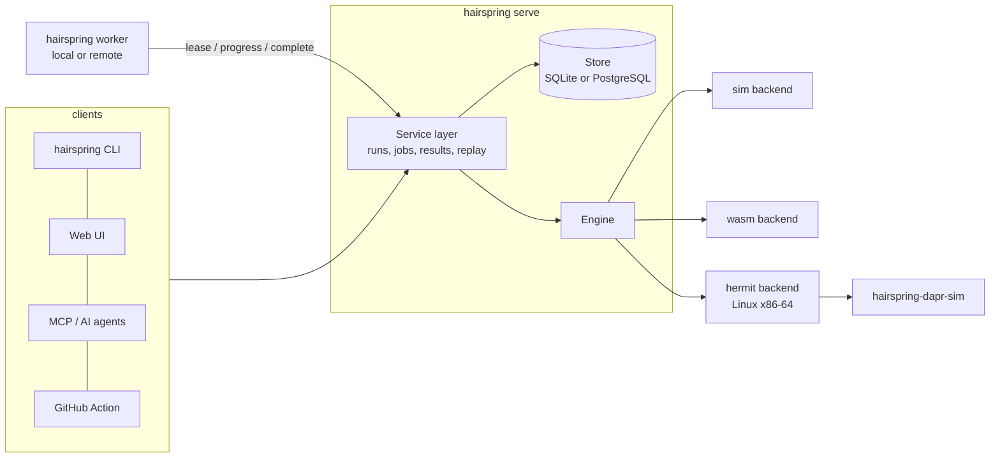

# Architecture



## One execution model, three ways to explore

- **Tree** (`sim`): states are plain data, so a clone is a snapshot. The explorer keeps a corpus of states with
  novel abstract signatures and branches from the least-visited. Failing paths are lists of **stable action ids**
  (never list indices, which break under shrinking) and are minimised by delta debugging.
- **Choice stream** (`wasm`): the guest asks the host for decisions (`choose(n)`); the sequence of answers is the
  trace. Shrinking deletes decisions while the *same kind* of failure persists. Linear memory and exported
  globals can be snapshotted and forked.
- **Seed space** (`process` under Hermit): the program is a black box; the scheduler seed is the input. Failures are
  confirmed by re-running the seed, and a bundle is the seed plus the pinned environment.

## Components

| Crate | Responsibility | Depends on |
|---|---|---|
| `hairspring-core` | `Sim`, explorer, shrinker, bundle format, point addresses and hashes, doctor. Std and `sha2` only | nothing |
| `hairspring-engine` | Type-erased registry, `hairspring.toml`, `Backend` trait, sim backend, JUnit/SARIF/text | core |
| `hairspring-store` | `Store` trait, SQLite, PostgreSQL, shared conformance suite | nothing |
| `hairspring-service` | The only place that mutates run/job state; validates and sanitises worker results | engine, store |
| `hairspring-hermit`, `hairspring-wasm` | Additional backends | engine |
| `hairspring-mcp`, `hairspring-server`, `hairspring-worker`, `hairspring-cli` | Front ends and plumbing | service |
| `hairspring-dapr` | Simulated Dapr sidecar (a standalone supervisor binary) | core |

Dependencies point one way: front ends depend on the service, the service on the engine and store.

## Job lifecycle

```
queued --lease--> running --finish_job--> done            (run: passed | failed | error)
   ^                 |  \--fail (attempts left)--> queued
   |                 |  \--fail / lease expired too often--> failed   (run finalised as error)
   \--cancel--> failed (run: cancelled)                    a running job is told to stop at its next progress report
```

- A lease lasts `lease_secs`; workers renew it with a heartbeat thread even when a run is silent.
- `finish_job` is one transaction: failure rows, run state, the `finished` event and closing the job. A stale
  worker cannot overwrite a finished or cancelled run.
- Jobs that exhaust their attempts through expiry are reported by `fail_expired_jobs` so their runs never hang.

## Trial storage (schema version 2)

Besides the run, job, failure and event tables, the store keeps one row per judged trial and the property
statistics of each run.

- `trials`: one row per judged trial (sequence number, seed, verdict, exit status, behaviour hash, schedule
  fingerprint, timing, the worker that reported it and whether that worker was trusted at the time, and a compact
  binary digest). Passing trials have rows too. The seed is stored as its bit pattern and served as a decimal
  string, because a scheduling seed can exceed 2^53.
- `run_catalog`: every property id a run has seen, with a small index that digests refer to.
- `run_properties`: the per-property counts for the run. Rates are not stored; `k` and `n` are, and the interval is
  computed when it is read.
- Kept detail (a versioned JSON record of one trial's folded events) and output tails go to the blob table, for
  findings, degraded trials, the first few trials and a sample, under a per-run allowance. A trial that did not fit
  is marked as dropped, never silently.

A worker sends its trials to `POST /api/worker/jobs/{job}/trials` in batches of at most 256 records and about
1.5 MiB. The server decodes every digest, checks each field against the protocol limits, applies the catalog
changes, and stores the batch all or nothing. Sending a batch again changes nothing. The server then folds the
digests itself when the job finishes and stores only its own figures; a worker's statistics are never read.

Trust: a worker has an administrator-set `trusted` flag (default off for remote workers, on for the process's own).
Folding on the server stops forged run-level figures but not invented per-trial results, so a figure may back a
claim only if every trial behind it came from a trusted worker and each failure it rests on was reproduced on a
trusted worker (`hairspring_service::claims`). Everything else is shown, labelled "unverified worker data". A run
whose stored rows do not match the count the worker reports is marked `ingest_incomplete`, and a run that was
incomplete or stopped at its first failure makes no must-hit (UNMET) claim.

A worker id is not a credential: any caller with a `run` token can read ids from the worker list. Registration
therefore issues each remote worker a random secret, shown once in the register reply; only its hash is stored, and
it never appears in the worker list. Every worker endpoint (`lease`, `progress`, `heartbeat`, `trials`, `complete`
and `fail`) requires `worker_secret` and refuses a request that names a worker without it, so neither the trust flag
nor a worker's lease can be borrowed by naming a worker's id; no endpoint identifies a worker by id alone. Only
`register` is open to any `run` token, and it returns the new worker's own secret. The secret is a bearer
credential: anyone who holds it acts as that worker. A worker that is pruned, or whose server database was replaced,
registers again and gets a new id and secret; **a new id starts untrusted**, so an administrator must set trust
again. Secrets are drawn from `/dev/urandom`, so the server needs a Unix host. A run that passed but holds fewer
trial rows than the budget it was started with (including one limited by wall-clock time) is marked
`ingest_incomplete` and makes no must-hit claim. The program's own text from a kind-mismatch is not kept in the
stored run summary, and ids appear in API replies only under `guest`.

Opening a version 1 database migrates it in place under one transaction (SQLite) or an advisory lock (PostgreSQL);
old runs read back with zero counts. **Back up the database before upgrading: there is no downgrade from version 2
to version 1**, and an older release refuses a version 2 database.

## Bundles

A bundle is a small text file: `seed`, `build`, `target`, `backend`, `param.*` and `path` (hex action ids or
recorded choices). Values are percent-escaped so they cannot inject fields. Replay refuses a bundle recorded
against different code where it can tell (the WASM module hash, the Hermit output hash).

## Point addresses and hashes

`hairspring_core::point` is a pure library for naming a place inside a trial. An address is
`p1~<run_id>~<seq>~<cut>`, where the cut is `end`, `s<k>` (sim, steps from the root) or `c<k>` (WASM, choices
made). Parsing is strict: at most 64 bytes, numbers of 1 to 19 digits with no leading zero, no empty parts and
no trailing text, and a cut kind that suits the run's backend.

A run's identity is a canonical list of every input that can change execution (executable and target content
hashes, run settings, and for Hermit the command line, environment, scheduler flags and loader hashes), one
`key=value` line each with percent-escaped values. A run with any input not recorded has no identity and so no
hash. The point hash is the SHA-256 of a version line, the identity text, the seed, the cut and the trace up to the cut;
the run id is not part of it. The command hash is the SHA-256 of a version line, the point hash and the
canonical JSON of the command (keys sorted, no spaces, integers as decimal strings).

## Determinism contract for targets

1. Everything nondeterministic goes through the runtime: time, randomness, scheduling, network, files.
2. Iteration order must be defined (no `HashMap` iteration in simulated code).
3. `hairspring doctor <target>` runs seeded walks twice and compares a per-step hash; run it in CI with several seeds.
