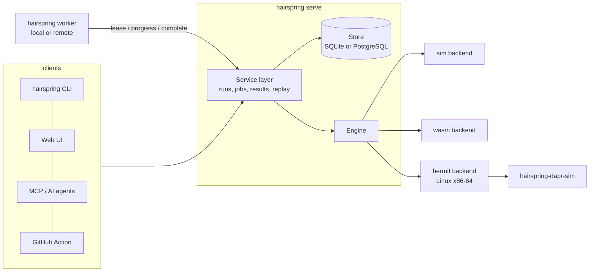

# Architecture



## One execution model, three ways to explore

- **Tree** (`sim`): states are plain data, so a clone is a snapshot. The explorer keeps a corpus of states with
  novel abstract signatures and branches from the least-visited. Failing paths are lists of **stable action ids**
  (never list indices, which break under shrinking) and are minimised by delta debugging.
- **Choice stream** (`wasm`): the guest asks the host for decisions (`choose(n)`); the sequence of answers is the
  trace. Shrinking deletes decisions while the *same kind* of failure persists. Linear memory and exported
  globals can be snapshotted and forked.
- **Seed space** (`process` under Hermit): the program is a black box; the scheduler seed is the input. Failures are
  confirmed by re-running the seed, and a bundle is the seed plus the pinned environment.

## Components

| Crate | Responsibility | Depends on |
|---|---|---|
| `hairspring-core` | `Sim`, explorer, shrinker, bundle format, point addresses and hashes, doctor. Std and `sha2` only | nothing |
| `hairspring-engine` | Type-erased registry, `hairspring.toml`, `Backend` trait, sim backend, JUnit/SARIF/text | core |
| `hairspring-store` | `Store` trait, SQLite, PostgreSQL, shared conformance suite | nothing |
| `hairspring-service` | The only place that mutates run/job state; validates and sanitises worker results | engine, store |
| `hairspring-hermit`, `hairspring-wasm` | Additional backends | engine |
| `hairspring-mcp`, `hairspring-server`, `hairspring-worker`, `hairspring-cli` | Front ends and plumbing | service |
| `hairspring-dapr` | Simulated Dapr sidecar (a standalone supervisor binary) | core |

Dependencies point one way: front ends depend on the service, the service on the engine and store.

## Job lifecycle

```
queued --lease--> running --finish_job--> done            (run: passed | failed | error)
   ^                 |  \--fail (attempts left)--> queued
   |                 |  \--fail / lease expired too often--> failed   (run finalised as error)
   \--cancel--> failed (run: cancelled)                    a running job is told to stop at its next progress report
```

- A lease lasts `lease_secs`; workers renew it with a heartbeat thread even when a run is silent.
- `finish_job` is one transaction: failure rows, run state, the `finished` event and closing the job. A stale
  worker cannot overwrite a finished or cancelled run.
- Jobs that exhaust their attempts through expiry are reported by `fail_expired_jobs` so their runs never hang.

## Trial storage (schema version 2)

Besides the run, job, failure and event tables, the store keeps one row per judged trial and the property
statistics of each run.

- `trials`: one row per judged trial (sequence number, seed, verdict, exit status, behaviour hash, schedule
  fingerprint, timing, the worker that reported it and whether that worker was trusted at the time, and a compact
  binary digest). Passing trials have rows too. The seed is stored as its bit pattern and served as a decimal
  string, because a scheduling seed can exceed 2^53.
- `run_catalog`: every property id a run has seen, with a small index that digests refer to.
- `run_properties`: the per-property counts for the run. Rates are not stored; `k` and `n` are, and the interval is
  computed when it is read.
- Kept detail (a versioned JSON record of one trial's folded events) and output tails go to the blob table, for
  findings, degraded trials, the first few trials and a sample, under a per-run allowance. A trial that did not fit
  is marked as dropped, never silently.

A worker sends its trials to `POST /api/worker/jobs/{job}/trials` in batches of at most 256 records and about
1.5 MiB. The server decodes every digest, checks each field against the protocol limits, applies the catalog
changes, and stores the batch all or nothing. Sending a batch again changes nothing. The server then folds the
digests itself when the job finishes and stores only its own figures; a worker's statistics are never read.

Trust: a worker has an administrator-set `trusted` flag (default off for remote workers, on for the process's own).
Folding on the server stops forged run-level figures but not invented per-trial results, so a figure may back a
claim only if every trial behind it came from a trusted worker and each failure it rests on was reproduced on a
trusted worker (`hairspring_service::claims`). Everything else is shown, labelled "unverified worker data". A run
whose stored rows do not match the count the worker reports is marked `ingest_incomplete`, and a run that was
incomplete or stopped at its first failure makes no must-hit (UNMET) claim.

A worker id is not a credential: any caller with a `run` token can read ids from the worker list. Registration
therefore issues each remote worker a random secret, shown once in the register reply; only its hash is stored, and
it never appears in the worker list. Every worker endpoint (`lease`, `progress`, `heartbeat`, `trials`, `complete`
and `fail`) requires `worker_secret` and refuses a request that names a worker without it, so neither the trust flag
nor a worker's lease can be borrowed by naming a worker's id; no endpoint identifies a worker by id alone. Only
`register` is open to any `run` token, and it returns the new worker's own secret. The secret is a bearer
credential: anyone who holds it acts as that worker. A worker that is pruned, or whose server database was replaced,
registers again and gets a new id and secret; **a new id starts untrusted**, so an administrator must set trust
again. Secrets are drawn from `/dev/urandom`, so the server needs a Unix host. A run that passed but holds fewer
trial rows than the budget it was started with (including one limited by wall-clock time) is marked
`ingest_incomplete` and makes no must-hit claim. The program's own text from a kind-mismatch is not kept in the
stored run summary, and ids appear in API replies only under `guest`.

Opening a version 1 database migrates it in place under one transaction (SQLite) or an advisory lock (PostgreSQL);
old runs read back with zero counts. **Back up the database before upgrading: there is no downgrade from version 2
to version 1**, and an older release refuses a version 2 database.

## Sweep mode

A run has a mode. `search` (the default, and the only behaviour before sweeps) ends at its first confirmed failure, so
its trial count was decided by its outcome and it has no rate. `sweep` runs every trial of its budget, continues after
a violation and stores every trial, so a rate can be stated for the trials it ran. The mode travels with the job
(`start_run_with_mode`, the `mode` field of `POST /api/runs` and of the MCP `start_run`, `hairspring test --sweep`), is
read back from the stored job, and is absent (so a search) in jobs queued before sweeps existed. It needs no schema
change: the trial rows added in version 2 already hold every verdict.

- **Trials.** The same unit as in search (one seed on the process and WebAssembly backends, one exploration round on a
  simulation target), run in the same batches of `parallelism`, judged in seed order, bounded by the trial budget, the
  wall-clock budget and, for simulations, the step budget. The progress callback is called after every batch and a
  cancel keeps the trials judged so far.
- **Rows.** One row per trial: seed, verdict (`pass`, `violation`, `inconclusive` for a timeout or a trial cut short by
  the wall-clock budget, `unusable`, `infra`), reason, exit status, behaviour hash, schedule fingerprint, counters and
  digest. The simulation and WebAssembly backends have no guest events, so their rows carry the excluded digest, as a
  process trial whose guest sent no events does.
- **Confirmation.** A violating trial is confirmed by re-running its seed, as in search, but the sweep goes on. Only the
  first ten violations are confirmed (`MAX_CONFIRMED_VIOLATIONS`): a flaky target would otherwise spend its budget on
  reruns. The row's reason ends with `rerun reproduced k/n` or `not confirmed: ...`. A violation counts toward the rate
  whether or not its rerun reproduced it; the note says what the rerun showed. Only the lowest failing seed gets a
  report (trace and replayable bundle), which is also what the run's failure row holds.
- **Not rated.** The rate is violations out of passes and violations. Timeouts, unusable trials and infrastructure
  failures are listed apart, are never in a denominator and are never described as passes. A host failure is an `infra`
  row and the sweep goes on, but three in a row end it as an error (the host is broken), keeping the rows. A sweep that
  rated nothing is an error, not a pass.
- **Report.** `RunOutcome::sweep` holds the counts (`trials` is always their sum) and up to ten failing seeds. The text
  report prints the counts, the failing seeds and the rate lines of the merged report code (Wilson interval, or the
  upper bound for zero violations, and the sensitivity line when trials were left out). A stored run's summary is counted
  by the server from the verdicts and seeds of its rows, never taken from a worker.
- **What the server decides.** The stored `stopped_at_first_failure` flag is false for a sweep, from the run's mode and
  not from the outcome, so its properties have rates. A failed sweep that holds fewer rows than its budget without
  having reached its wall-clock or step limit (what a worker that predates sweeps produces: it ignores the mode and
  stops at the first failure) is marked `ingest_incomplete`, like a short pass. A worker's record numbered at or past the
  run's trial budget is refused, a sweep summary that contradicts itself or the trial count is refused, and the worker's
  summary is dropped.
- **Memory.** A sweep keeps a record per trial until it finishes, so its in-memory log is bounded
  (`HermitSettings::sweep_kept_bytes` and `sweep_digest_bytes`). Kept detail and output stop at 64 MiB: the later rows
  stay and leave those parts out. Digests are never altered or left out of a row (they carry the property statistics, and
  a catalog update must reach the server before a digest refers to it). Instead, a sweep whose digests reach 64 MiB, the
  server's own per-run allowance (`MAX_DIGEST_BYTES_PER_RUN`; a test keeps the two equal), ends after the batch in
  progress, so it holds at most one batch more. It then holds fewer rows than its budget without having run out of time,
  so the server marks it incomplete and it makes no must-hit claim. The server applies its own allowance on top, with
  the stand-ins described below.

## Trial trees (schema version 3)

Version 3 adds four tables and changes nothing in the existing ones (`runs` and `trials` keep their columns and rows).
Nothing writes to them yet except through the store interface; the server routes that use them come later.

- `run_identity`: the execution inputs of a run, recorded once. A run whose identity is incomplete has no point
  identity.
- `trees`: one tree per root run (its id is the root run's id). `identity_hash` is NULL for a tree without point
  identity: such a tree can be read, but no branch run can be attached to it.
- `trial_lineage`: one row per tree node, pointing at a stored trial. The server derives the node number (dense per
  tree), depth and a materialised path (the unsigned LEB128 encodings of the node numbers from the root, stored as a
  BLOB, so the descendants of a node are one byte range). The parent always has a smaller node number, and a SQLite
  CHECK keeps a TEXT value out of the path column. At most 512 levels, 1,024 children per parent and cut, 100,000
  nodes per tree and 1,000 branch runs per tree.
- `tree_branches`: one row per branch run created from a point of a tree, with the stored command and its hash, so a
  repeated command is answered from the stored branch. A branch attaches only once both the tree's root run and the run
  of the source node have finished (a finished run never starts another attempt, so those nodes cannot be deleted
  under it). A run is a tree's root or a branch, not both.

The node cap counts node numbers handed out, not rows: when a retried attempt deletes a run's nodes, the tree's counter
does not go back, so a number never names two nodes and gaps in the numbering stand.

Subtree queries (`subtree_descendants`, `subtree_tally`, `subtree_first_failing`) exist in two forms behind one query
layer: a recursive query over `parent_node`, and a range scan of the path. Both return the same rows. SQLite always
uses the recursive form; PostgreSQL uses it below 100,000 nodes in the tree and the path form at or above. Ancestors
always use the recursive form, and children are paged by keyset on the parent index. A recursive-form descendant
listing for a node with more than 50,000 descendants is refused (`LimitExceeded`): page by children instead.

Opening a current database runs no DDL; it only checks that the tables exist. Opening a version 2 database adds the
tree tables in the same transaction as the version bump.

**Downgrade to version 2** (offline; back up first, nothing is downgraded automatically):
`hairspring_store::downgrade_sqlite` and `downgrade_postgres` (also `cargo run -p hairspring-store --example
store_downgrade`) drop the four tree tables (and the tables of versions 4 and 5, if present) and set the version to 2.
Branch runs, which exist only because of version 3,
are listed first and kept by default as ordinary runs; `--drop-branch-runs` deletes them, with their trials, jobs,
events and failures, in the same transaction and removes the blobs nothing else refers to. `--dry-run` only reports.
Upgrading again later restores empty tree tables.

## Digest allowance and stored coverage (schema version 4)

Version 4 adds two tables and, like version 3, changes nothing in `runs` or `trials`, so migrating a database with
many trials rewrites no existing row. A run with no row in either table has used no allowance and has no stored series.

- `run_digest_use`: the bytes of trial digests a run holds and how many trials had their digest replaced. A run may
  hold `ServiceConfig::digest_bytes_per_run` bytes (default `MAX_DIGEST_BYTES_PER_RUN`, 64 MiB; the value is a
  proposal). Every read of a run decodes its digests, and a registered worker could otherwise store up to 1 MiB per
  trial. A trial whose digest would pass the allowance is **not refused and not dropped**: the server stores the same
  trial (sequence number, seed, verdict, counters, kept detail and output, and every flag the worker reported such as
  `timed_out` or `degraded`) with an empty digest marked as excluded, and starts its reason with
  `DIGEST_CAPPED_REASON`. Only the digest, the ratings (`rated`, `claimable`) and the reason change. The trial counts
  toward no statistic, the trial list and detail show `digest_capped`, and the run finishes marked `ingest_incomplete`,
  so it makes no must-hit claim. Its completion reads `digest_allowance_used_up` ("digest allowance used up: trial
  data is incomplete"), not "ended early", which would blame its caller. A worker cannot send that reason text itself,
  so `digest_capped` is derived from the reason prefix rather than from a stored flag; a build that changed the
  prefix would stop showing old rows as capped (the run-level count in `run_digest_use` would still be right). Sending
  a batch again after a replacement changes nothing.
  The service builds the stand-ins only when the batch could pass the allowance by what it knows; otherwise the store
  asks for them (`NeedsStandIn`) and the batch is sent once more. The store trusts the stand-in it is given.
- `run_coverage`: the run's coverage series (`GET /api/runs/{id}/coverage`), worked out once when its job finishes and
  stored with it. A read of a finished run scans no trials, in this process or after a restart. A run finished before
  version 4, or whose stored series cannot be used, is scanned once on first read and then served from memory. A run
  that is still open is scanned on every read.

`Store::reporters_of` names the worker behind each failing seed from the seed index, reading only the seed, sequence
number and worker columns of the matching rows. The claim gate used to page through whole trial rows for this.

The coverage series and the property fold each read the run's digests once when its job finishes, while the job's
lease is still held, so no trial can be added between them; a read of the finished run then scans nothing.

Opening a version 3 database adds the two tables in the same transaction as the version bump, and a version 3 database
that lost one of its own tables or indexes is refused rather than repaired, on both backends. An older release refuses
a version 4 database; the offline downgrade above removes the two tables. **Stop every older (version 3) server and
worker before upgrading**: a version 3 process that is still running does not know the allowance and neither writes
nor clears `run_digest_use`, so runs it ingests meanwhile are not counted.

## Confirmation checks (schema version 5)

Version 5 adds one table, `failure_checks`, and changes nothing else (`runs`, `failures` and `trials` keep their columns
and rows, so migrating rewrites no existing row). A failure with no row has never been confirmed.

- A confirmation is one run of the pipeline (see [Confirming a failure](determinism.md#confirming-a-failure)) on a
  failure: up to eight checks, written in one transaction under an id derived from its content, so a retry stores
  nothing twice and the same id with different content is refused. A failure holds at most 200 checks (a confirmation
  that would pass that drops the oldest whole confirmations), and each text column at most 16 KiB. Rows list by creation
  time and then by write order (`rowid` on SQLite, a `seq` column on PostgreSQL), never by id.
- A check keeps its kind (`same_seed_rerun`, `bundle_replay`, `fixed_control`, `strict_verify`), status (`pass`, `fail`,
  `inconclusive`, `skipped`), counts of passed, failed and inconclusive runs, a record of the Hermit command (not a paste-and-run line), bounded JSON for
  its detail, the hashes it saw, the environment identity it ran in, when it started and finished, and the runner and
  whether it was trusted when it reported. The runner label is never served.
- The service validates every reported check before it reaches the store (`Service::record_confirmation`): enumerated
  kind and status, counts that fit the status and the rerun limit, sane times, hashes that are hex, environment fields
  that belong to the identity, and text cut to size with control characters removed. An impossible result is refused whole.
- A failure's state is derived from its checks at read time (`candidate`, `rerun_repeated`, `confirmed`, `verified`,
  `not_reproducible`, `control_failed`); nothing stores it, so it cannot drift from the checks. It is derived from one
  confirmation (the newest that finished), never from checks of different confirmations. The run's claim uses it, from
  the confirmations of trusted runners only: a failure counts as reproduced for the claim gate only when that state is
  confirmed or verified.

The pipeline runs where the engine is: the CLI's own process, or the server's embedded engine. It is bounded (at most ten
reruns, each limited by the target's trial timeout, and a wall budget of at most ten minutes) and cancellable: the engine
stops between runs (the replay and each skid retry included) and records what did not run as skipped, for a caller that
uses the progress callback; Ctrl-C on the CLI stops hairspring and may leave Hermit children running, as for
`hairspring test`. A remote worker does not run confirmations yet.

Opening a version 4 database adds the table and its index in the same transaction as the version bump. A version 4
database that lost one of its own tables or indexes is refused rather than repaired, on both backends, and a current
database is only looked at (no DDL). An older release refuses a version 5 database. **Back up first; stop every older
server and worker before upgrading.** The offline downgrade (`hairspring_store::downgrade_sqlite` and
`downgrade_postgres`, also `cargo run -p hairspring-store --example store_downgrade`) now accepts versions 3, 4 and 5 and
drops the version 5 table first, so stored checks are lost by a downgrade.

## Bundles

A bundle is a small text file: `seed`, `build`, `target`, `backend`, `param.*` and `path` (hex action ids or
recorded choices). Values are percent-escaped so they cannot inject fields. Replay refuses a bundle recorded
against different code where it can tell (the WASM module hash, the Hermit output hash).

A bundle that records an execution environment (a fixed list of `param.host.*`, `param.hermit.*`, `param.env.*` and
`param.target.*` names) starts with `hairspring-bundle v3`; every other bundle is still written as v2, so older readers keep
working. Readers accept v1, v2 and v3. See [Recorded environment](determinism.md#recorded-environment).

## Point addresses and hashes

`hairspring_core::point` is a pure library for naming a place inside a trial. An address is
`p1~<run_id>~<seq>~<cut>`, where the cut is `end`, `s<k>` (sim, steps from the root) or `c<k>` (WASM, choices
made). Parsing is strict: at most 64 bytes, numbers of 1 to 19 digits with no leading zero, no empty parts and
no trailing text, and a cut kind that suits the run's backend.

A run's identity is a canonical list of every input that can change execution (executable and target content
hashes, run settings, and for Hermit the command line, environment, scheduler flags and loader hashes), one
`key=value` line each with percent-escaped values. A run with any input not recorded has no identity and so no
hash. The point hash is the SHA-256 of a version line, the identity text, the seed, the cut and the trace up to the cut;
the run id is not part of it. The command hash is the SHA-256 of a version line, the point hash and the
canonical JSON of the command (keys sorted, no spaces, integers as decimal strings).

## Determinism contract for targets

1. Everything nondeterministic goes through the runtime: time, randomness, scheduling, network, files.
2. Iteration order must be defined (no `HashMap` iteration in simulated code).
3. `hairspring doctor <target>` runs seeded walks twice and compares a per-step hash; run it in CI with several seeds.
