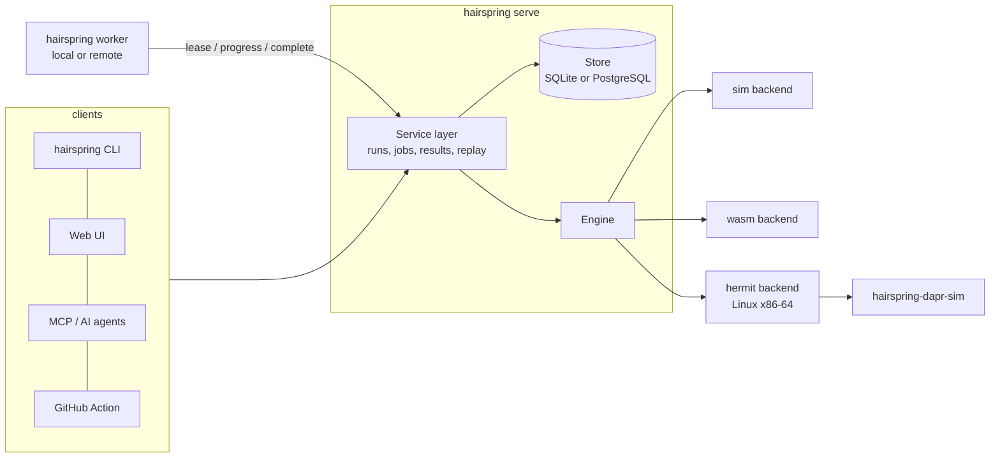

# Architecture



## One execution model, three ways to explore

- **Tree** (`sim`): states are plain data, so a clone is a snapshot. The explorer keeps a corpus of states with
  novel abstract signatures and branches from the least-visited. Failing paths are lists of **stable action ids**
  (never list indices, which break under shrinking) and are minimised by delta debugging.
- **Choice stream** (`wasm`): the guest asks the host for decisions (`choose(n)`); the sequence of answers is the
  trace. Shrinking deletes decisions while the *same kind* of failure persists. Linear memory and exported
  globals can be snapshotted and forked.
- **Seed space** (`process` under Hermit): the program is a black box; the scheduler seed is the input. Failures are
  confirmed by re-running the seed, and a bundle is the seed plus the pinned environment.

## Components

| Crate | Responsibility | Depends on |
|---|---|---|
| `hairspring-core` | `Sim`, explorer, shrinker, bundle format, doctor. Std only | nothing |
| `hairspring-engine` | Type-erased registry, `hairspring.toml`, `Backend` trait, sim backend, JUnit/SARIF/text | core |
| `hairspring-store` | `Store` trait, SQLite, PostgreSQL, shared conformance suite | nothing |
| `hairspring-service` | The only place that mutates run/job state; validates and sanitises worker results | engine, store |
| `hairspring-hermit`, `hairspring-wasm` | Additional backends | engine |
| `hairspring-mcp`, `hairspring-server`, `hairspring-worker`, `hairspring-cli` | Front ends and plumbing | service |
| `hairspring-dapr` | Simulated Dapr sidecar (a standalone supervisor binary) | core |

Dependencies point one way: front ends depend on the service, the service on the engine and store.

## Job lifecycle

```
queued --lease--> running --finish_job--> done            (run: passed | failed | error)
   ^                 |  \--fail (attempts left)--> queued
   |                 |  \--fail / lease expired too often--> failed   (run finalised as error)
   \--cancel--> failed (run: cancelled)                    a running job is told to stop at its next progress report
```

- A lease lasts `lease_secs`; workers renew it with a heartbeat thread even when a run is silent.
- `finish_job` is one transaction: failure rows, run state, the `finished` event and closing the job. A stale
  worker cannot overwrite a finished or cancelled run.
- Jobs that exhaust their attempts through expiry are reported by `fail_expired_jobs` so their runs never hang.

## Bundles

A bundle is a small text file: `seed`, `build`, `target`, `backend`, `param.*` and `path` (hex action ids or
recorded choices). Values are percent-escaped so they cannot inject fields. Replay refuses a bundle recorded
against different code where it can tell (the WASM module hash, the Hermit output hash).

## Determinism contract for targets

1. Everything nondeterministic goes through the runtime: time, randomness, scheduling, network, files.
2. Iteration order must be defined (no `HashMap` iteration in simulated code).
3. `hairspring doctor <target>` runs seeded walks twice and compares a per-step hash; run it in CI with several seeds.
