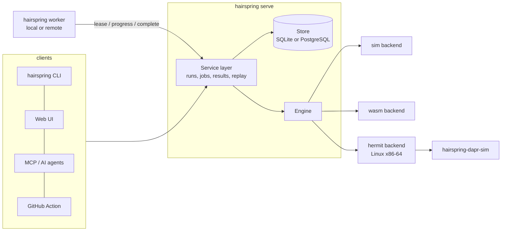

# Architecture



## One execution model, three ways to explore

- **Tree** (`sim`): states are plain data, so a clone is a snapshot. The explorer keeps a corpus of states with
  novel abstract signatures and branches from the least-visited. Failing paths are lists of **stable action ids**
  (never list indices, which break under shrinking) and are minimised by delta debugging.
- **Choice stream** (`wasm`): the guest asks the host for decisions (`choose(n)`); the sequence of answers is the
  trace. Shrinking deletes decisions while the *same kind* of failure persists. Linear memory and exported
  globals can be snapshotted and forked.
- **Seed space** (`process` under Hermit): the program is a black box; the scheduler seed is the input. Failures are
  confirmed by re-running the seed, and a bundle is the seed plus the pinned environment.

## Components

| Crate | Responsibility | Depends on |
|---|---|---|
| `hairspring-core` | `Sim`, explorer, shrinker, bundle format, point addresses and hashes, doctor. Std and `sha2` only | nothing |
| `hairspring-engine` | Type-erased registry, `hairspring.toml`, `Backend` trait, sim backend, JUnit/SARIF/text | core |
| `hairspring-store` | `Store` trait, SQLite, PostgreSQL, shared conformance suite | nothing |
| `hairspring-service` | The only place that mutates run/job state; validates and sanitises worker results | engine, store |
| `hairspring-hermit`, `hairspring-wasm` | Additional backends | engine |
| `hairspring-mcp`, `hairspring-server`, `hairspring-worker`, `hairspring-cli` | Front ends and plumbing | service |
| `hairspring-dapr` | Simulated Dapr sidecar (a standalone supervisor binary) | core |

Dependencies point one way: front ends depend on the service, the service on the engine and store.

## Job lifecycle

```
queued --lease--> running --finish_job--> done            (run: passed | failed | error)
   ^                 |  \--fail (attempts left)--> queued
   |                 |  \--fail / lease expired too often--> failed   (run finalised as error)
   \--cancel--> failed (run: cancelled)                    a running job is told to stop at its next progress report
```

- A lease lasts `lease_secs`; workers renew it with a heartbeat thread even when a run is silent.
- `finish_job` is one transaction: failure rows, run state, the `finished` event and closing the job. A stale
  worker cannot overwrite a finished or cancelled run.
- **Trial temporary files.** A trial timeout and Ctrl-C end Hermit with `SIGKILL`, which skips the clean-up Hermit does
  for its own temporary files. So each Hermit trial gets a directory the engine owns and removes itself, after a
  timeout as after any other end, under `trial_dir` (`/tmp` by default). Hermit's temporary
  directory is pointed at it: `TMPDIR` and `HERMIT_VERIFY_TMPDIR` under `--base-env=minimal` or `empty`, and only
  `HERMIT_VERIFY_TMPDIR` under the default base environment, which passes Hermit's environment to the guest. So in that
  mode Hermit's private guest `/tmp` and its `/etc/group` copy can still be left after a timeout. No `--tmp` is
  passed for this, because, from reading Hermit's source (not run live), it could change the guest's `/proc/self/mountinfo`. See [determinism.md](determinism.md#hermits-temporary-files-and-a-trial-timeout).
- Jobs that exhaust their attempts through expiry are reported by `fail_expired_jobs` so their runs never hang.
- **Ctrl-C.** `hairspring test` and `hairspring confirm` catch the first SIGINT (a second one ends the process in the
  usual way). The foreground run is cancelled like any other cancel, so it ends `cancelled` and keeps the trials already
  stored, and every Hermit trial in progress is killed through its process group, the kill a trial timeout uses (a child
  that calls `setsid` leaves the group and survives). No further trial starts. A foreground command leases only the
  job of the run it started; so does the MCP `start_run` tool when the server runs runs inline (`hairspring mcp`).
  Jobs of other runs (for example one left with an expired lease by a hard kill) are not
  leased, run or marked `running` by it; they are left to workers, so run `hairspring worker` if such a job must
  finish. A command that is interrupted leases nothing and cancels its own run. A command that cannot lease its own job
  because another process holds it cancels its run at once instead of waiting. The CLI says so
  and exits with status 130, also when Ctrl-C lands after the last run finished on its own (that run stands as stored).
  Each guest runs in a process group of its own, so the terminal's SIGINT never reaches it directly. `hairspring serve`
  and `hairspring worker` are unchanged. A confirmation that is interrupted stores the checks that finished and records
  the rest as skipped, as for any cancel.
- **A refused result.** A result the server refuses (for example more than 16 failure reports, or bundles totalling more
  than 1.5 MiB) is refused whole. A worker in the CLI's own process then ends the run as an `error` that says the result
  was refused, and closes the job; a remote worker is told of the refusal.

## Trial storage (schema version 2)

Besides the run, job, failure and event tables, the store keeps one row per judged trial and the property
statistics of each run.

- `trials`: one row per judged trial (sequence number, seed, verdict, exit status, behaviour hash, schedule
  fingerprint, timing, the worker that reported it and whether that worker was trusted at the time, and a compact
  binary digest). Passing trials have rows too. The seed is stored as its bit pattern and served as a decimal
  string, because a scheduling seed can exceed 2^53.
- `run_catalog`: every property id a run has seen, with a small index that digests refer to.
- `run_properties`: the per-property counts for the run. Rates are not stored; `k` and `n` are, and the interval is
  computed when it is read.
- Kept detail (a versioned JSON record of one trial's folded events) and output tails go to the blob table, for
  findings, degraded trials, the first few trials and a sample, under a per-run allowance. A trial that did not fit
  is marked as dropped, never silently.

A worker sends its trials to `POST /api/worker/jobs/{job}/trials` in batches of at most 256 records and about
1.5 MiB. The server decodes every digest, checks each field against the protocol limits, applies the catalog
changes, and stores the batch all or nothing. Sending a batch again changes nothing. The server then folds the
digests itself when the job finishes and stores only its own figures; a worker's statistics are never read.

Trust: a worker has an administrator-set `trusted` flag (default off for remote workers, on for the process's own).
Folding on the server stops forged run-level figures but not invented per-trial results, so a figure may back a
claim only if every trial behind it came from a trusted worker and each failure it rests on was reproduced on a
trusted worker (`hairspring_service::claims`). Everything else is shown, labelled "unverified worker data". A run
whose stored rows do not match the count the worker reports is marked `ingest_incomplete`, and a run that was
incomplete or stopped at its first failure makes no must-hit (UNMET) claim.

A worker id is not a credential: any caller with a `run` token can read ids from the worker list. Registration
therefore issues each remote worker a random secret, shown once in the register reply; only its hash is stored, and
it never appears in the worker list. Every worker endpoint (`lease`, `progress`, `heartbeat`, `trials`, `complete`
and `fail`) requires `worker_secret` and refuses a request that names a worker without it, so neither the trust flag
nor a worker's lease can be borrowed by naming a worker's id; no endpoint identifies a worker by id alone. Only
`register` is open to any `run` token, and it returns the new worker's own secret.

Requests to `/api/` (except `/api/health`) and `/mcp` are limited per caller. `hairspring serve --rate-limit N`
(default 1200, `0` disables) allows `N` requests in a fixed one-minute window and answers `429 Too Many Requests` with
`Retry-After: 60` past it. A request with a valid token counts against that token's own allowance. Every other
request (no token, or a wrong one) counts against one allowance per client address: the IPv4 address, or the /64 for
IPv6, taken from the connection, or from `X-Forwarded-For` only when the connection comes from a proxy named with
`--trusted-proxy` (see "Client address behind a proxy" below). While an address's anonymous allowance is used
up, a valid token from that address is refused as well, without counting against either allowance; otherwise the
right token would be told apart from wrong guesses by its `200`. The window is fixed and restarts with the next
request after it ends, so valid tokens from that address are refused while such traffic continues, and for up to a
minute after it stops. That is the trade-off of limiting guessing per address; operators who need otherwise should put
a limiter in front of the server. `/api/health` is never refused, but a health request
that carries an `Authorization` header is counted by the same rule, and the organisation name is added only when the
request would have been let through and the token is valid; otherwise the answer is still `200` without the name.
Health without the header is never counted. The windows are kept in server memory in a bounded table (see
SECURITY.md for how it is evicted).

Registration is limited per token. `hairspring serve --register-limit N` (default 100, `0` disables) makes `register`
answer `429 Too Many Requests` with a `Retry-After` header once a token has made `N` registration attempts in a fixed
one-hour window. The window starts at the token's first counted attempt, so up to `2N` attempts can pass either side of
a boundary, and `Retry-After` is always the full window (3600 seconds), not the time left. Attempts that pass the role
check count even if they then fail (for example `caps is too large` or `worker limit reached`). Every header spelling
of one token (extra spaces or tabs) shares one allowance, and when the server runs with no tokens (loopback only) all
callers share a single allowance. The count is kept in server memory, so it is the same on SQLite and PostgreSQL, needs
no schema change and starts again from zero when the server restarts.

The limit slows one token filling the worker table but does not prevent it. The table holds at most 1000 workers, and a
worker is pruned only once it is more than 24 hours old, so at the default one token can reach the cap in about ten
hours and keep it full, because 100 registrations an hour is 2400 in 24 hours. To stop a single token filling the cap,
set `--register-limit` lower than the cap divided by 24 (41 or fewer per hour keeps one token under 1000 live workers).
The secret is a bearer
credential: anyone who holds it acts as that worker. A worker that is pruned, or whose server database was replaced,
registers again and gets a new id and secret; **a new id starts untrusted**, so an administrator must set trust
again. Secrets are drawn from `/dev/urandom`, so the server needs a Unix host. A run that passed but holds fewer
trial rows than the budget it was started with (including one limited by wall-clock time) is marked
`ingest_incomplete` and makes no must-hit claim. The program's own text from a kind-mismatch is not kept in the
stored run summary, and ids appear in API replies only under `guest`.

Opening a version 1 database migrates it in place under one transaction (SQLite) or an advisory lock (PostgreSQL);
old runs read back with zero counts. **Back up the database before upgrading: there is no downgrade from version 2
to version 1**, and an older release refuses a version 2 database.

## Sweep mode

A run has a mode. `search` (the default, and the only behaviour before sweeps) ends at its first confirmed failure, so
its trial count was decided by its outcome and it has no rate. `sweep` runs every trial of its budget, continues after
a violation and stores every trial, so a rate can be stated for the trials it ran. The mode travels with the job
(`start_run_with_mode`, the `mode` field of `POST /api/runs` and of the MCP `start_run`, `hairspring test --sweep`), is
read back from the stored job, and is absent (so a search) in jobs queued before sweeps existed. The trial rows
added in version 2 already hold every verdict; since schema version 6 the mode is also stored in `runs.mode` (see
Stored run mode).

- **Trials.** The same unit as in search (one seed on the process and WebAssembly backends, one exploration round on a
  simulation target), run in the same batches of `parallelism`, judged in seed order, bounded by the trial budget, the
  wall-clock budget and, for simulations, the step budget. The progress callback is called after every batch and a
  cancel keeps the trials judged so far.
- **Rows.** One row per trial: seed, verdict (`pass`, `violation`, `inconclusive` for a timeout or a trial cut short by
  the wall-clock budget, `unusable`, `infra`), reason, exit status, behaviour hash, schedule fingerprint, counters and
  digest. The simulation and WebAssembly backends have no guest events, so their rows carry the excluded digest, as a
  process trial whose guest sent no events does.
- **Confirmation.** A violating trial is confirmed by re-running its seed, as in search, but the sweep goes on. Only the
  first ten violations are confirmed (`MAX_CONFIRMED_VIOLATIONS`): a flaky target would otherwise spend its budget on
  reruns. A confirmation is held to the sweep's wall-clock budget and asks the progress callback first, so a cancel is
  noticed before it, not only between batches. The row's reason ends with `same-output reruns k/n` (reruns with the
  same behaviour hash and failing properties), or `not confirmed: ...` (limit reached, out of budget, cancelled). A
  violation counts toward the rate whether or not its reruns matched. The check is before a confirmation, not between
  its reruns, so a sweep overruns its wall-clock budget by at most one confirmation (`repro_runs` reruns of up to a
  trial's timeout each; a test pins the bound); the note says what they showed. The lowest failing seed gets a
  report (trace and replayable bundle), which is also what the run's first failure row holds; so does each later seed
  at which a property fails for the first time (`RunOutcome::more_failures`, at most 16 reports in all), so the claim gate
  can see every first-failure seed. Those later reports carry the sweep's own rerun note like the first (reruns of the
  seed, made even past the limit on confirmed violations), but the sweep does not run the full confirmation pipeline by
  itself: `hairspring confirm <run id>` does that for every row, and `hairspring test --sweep --confirm` does the same
  for the rows of the sweep it has just run (CLI only: the server does not schedule confirmations for finished sweep
  runs, and remote workers do not run them). A sweep that sees one property fail has no extra report, except
  that a property failing after a first failure that named none gets its own. The server refuses further failures
  unless the run is a sweep with a first failure, with strictly rising seeds and at most 1.5 MiB of bundles in all.
- **Simulation sweeps are not confirmed.** A failing seed from a simulation (`sim`) target, in a sweep or a search, cannot be confirmed: `hairspring confirm` stops with ``error: no backend available for target kind ``confirm` is not supported by the sim backend` `` (the stray backticks are in the message) and nothing is stored. Only `process` targets can be confirmed.
- **Not rated.** The rate is violations out of passes and violations. Timeouts, unusable trials and infrastructure
  failures (labelled "failed in the host") are listed apart, are never in a denominator and are never described as
  passes. A host failure is an `infra` row and the sweep goes on, but three in a row end it as an error (the host is
  broken), keeping the rows. A sweep that rated nothing is an error, not a pass. A sweep that ends in an error
  (cancelled, or the host kept failing) labels its figures `partial`: it stopped when something happened, so optional
  stopping can bias them.
- **Report.** `RunOutcome::sweep` holds the counts (`trials` is always their sum) and up to ten failing seeds. The text
  report prints the counts, the failing seeds and the rate lines of the merged report code (Wilson interval, or the
  upper bound for zero violations, and the sensitivity line when trials were left out). A stored run's summary is counted
  by the server from the verdicts and seeds of its rows, never taken from a worker.
- **What the server decides.** The stored `stopped_at_first_failure` flag is false for a sweep, from the run's mode and
  not from the outcome, so its properties have rates. A failed sweep that holds fewer rows than its budget without
  having reached its wall-clock or step limit (what a worker that predates sweeps produces: it ignores the mode and
  stops at the first failure) is marked `ingest_incomplete`, like a short pass; for a failed sweep only the server's clock
  counts as a limit, never the worker's own step count. Such a run (`EndedEarly` in the completion label) has no
  `sweep` summary, and its report states counts only, not a rate, whatever its status (`RunOutcome::rate_withheld`,
  set when the server rebuilds the stored run; not stored). The same holds for a run labelled `DigestAllowanceUsedUp`
  (any stand-in gives that label) that also holds fewer rows than its budget: it stopped short with no limit the server
  can verify, so its summary is withheld too. Only a run that ran its whole budget and is incomplete solely because the
  server replaced digests by stand-ins keeps its summary and its rate, since the summary reads verdicts and seeds. A
  time-limited sweep that also had stand-ins is withheld as well (the label cannot tell the two apart). "Fewer rows
  than its budget" is counted from the rows the server holds, and the report's trial and inconclusive counts are too:
  the trial count a worker puts in its outcome (stored as `run.trials`, for display) decides nothing about a sweep. For
  a withheld sweep the per-property cells in the report (for example `PASS always 'c.id'  0/1 ... exact one-sided 95%
  upper bound 95.00%`) are property-level figures over the trials that reported that id, not the sweep's rate.
  `sweep_partial` on the run marks a summary from a sweep that ended in an error or
  was cancelled. A worker's record numbered at or past the run's trial budget is refused, and so
  is a sweep record whose seed is not the run's first seed plus its number (wrapping), so a worker cannot name an
  arbitrary failing seed. A sweep summary that contradicts itself or the trial count is refused, and the worker's
  summary is dropped. The server serves its own summary as the `sweep` field of `GET /api/runs/{id}` and the MCP
  `get_run`, once the run is over.
- **Memory.** A sweep keeps a record per trial until it finishes, so its in-memory log is bounded
  (`HermitSettings::sweep_kept_bytes` and `sweep_digest_bytes`). Kept detail and output stop at 64 MiB: the later rows
  stay and leave those parts out. Digests are never altered or left out of a row (they carry the property statistics, and
  a catalog update must reach the server before a digest refers to it). Instead, a sweep whose digests reach 64 MiB, the
  server's own per-run allowance (`MAX_DIGEST_BYTES_PER_RUN`; a test keeps the two equal), ends after the batch in
  progress, so it holds at most one batch more. It then holds fewer rows than its budget without having run out of time,
  so the server marks it incomplete, withholds its summary and rate, and it makes no must-hit claim. Its label does not
  name the memory limit: it reads "ended early", or "digest allowance used up" when the server also used stand-ins,
  whichever the case, and the summary is withheld either way. The worker cannot see the server's configurable allowance (`digest_bytes_per_run`): a server
  configured below the default applies its stand-ins as described below, and a worker's `sweep_digest_bytes` should be
  lowered to match if its memory matters more than the stand-ins.
- **Step count of a passing sweep.** The number of steps a sweep that passed is said to have used is the worker's own
  figure: the server does not work it out. It is used only to decide whether a sweep that holds fewer rows than its
  budget stopped at its step limit, so a worker that reports a step count it did not spend can make a short sweep look
  as if it reached the limit. A failed sweep's step count is ignored for that decision, and only the server's clock counts.
- **Simulation rounds.** A simulation trial is one exploration round of up to 100,000 steps, and the rounds share the
  step budget, so a default budget (200,000 steps) runs two rounds. Raise the step budget (`--budget-steps`,
  `max_steps`) to run more.

## Trial trees (schema version 3)

Version 3 adds four tables and changes nothing in the existing ones (`runs` and `trials` keep their columns and rows).
Nothing writes to them yet except through the store interface; the server routes that use them come later.

- `run_identity`: the execution inputs of a run, recorded once. A run whose identity is incomplete has no point
  identity.
- `trees`: one tree per root run (its id is the root run's id). `identity_hash` is NULL for a tree without point
  identity: such a tree can be read, but no branch run can be attached to it.
- `trial_lineage`: one row per tree node, pointing at a stored trial. The server derives the node number (dense per
  tree), depth and a materialised path (the unsigned LEB128 encodings of the node numbers from the root, stored as a
  BLOB, so the descendants of a node are one byte range). The parent always has a smaller node number, and a SQLite
  CHECK keeps a TEXT value out of the path column. At most 512 levels, 1,024 children per parent and cut, 100,000
  nodes per tree and 1,000 branch runs per tree.
- `tree_branches`: one row per branch run created from a point of a tree, with the stored command and its hash, so a
  repeated command is answered from the stored branch. A branch attaches only once both the tree's root run and the run
  of the source node have finished (a finished run never starts another attempt, so those nodes cannot be deleted
  under it). A run is a tree's root or a branch, not both.

**Field checks.** Tree and command fields come from workers, which are untrusted. Both stores refuse, with a typed
`Invalid` rejection, an `edge_ref`, `point_hash` or `command_hash` that is not 64 lower-case hexadecimal digits (a
SHA-256 digest), and a `command_json` that is empty, over 64 KiB, holds a NUL, nests more than 32 levels deep or is not
well-formed JSON. The service layer (`hairspring_service::check_new_node`, `check_new_branch`, `check_command_json`)
makes the same checks first and names the field in a `TreeFieldError`; it also requires the command to be a JSON object,
so a bare number, string or array is refused, and refuses a command in which any object repeats a key (a parser that
keeps the last value would let two different texts read as one command). Nothing calls these yet, because no server
route accepts tree input; the routes will call them before touching the store. Not checked: that `command_hash` equals
the hash of `command_json`. It is a cache key the worker supplies. The only defined command hash is built from a typed
command, with integers written as strings, and nothing defines a mapping from arbitrary command JSON to that form or a
hash of the exact text, so a check would have nothing to be held to.

The node cap counts node numbers handed out, not rows: when a retried attempt deletes a run's nodes, the tree's counter
does not go back, so a number never names two nodes and gaps in the numbering stand.

Subtree queries (`subtree_descendants`, `subtree_tally`, `subtree_first_failing`) exist in two forms behind one query
layer: a recursive query over `parent_node`, and a range scan of the path. Both return the same rows. SQLite always
uses the recursive form; PostgreSQL uses it below 100,000 nodes in the tree and the path form at or above. Ancestors
always use the recursive form, and children are paged by keyset on the parent index. A recursive-form descendant
listing for a node with more than 50,000 descendants is refused (`LimitExceeded`): page by children instead.

Opening a current database runs no DDL; it only checks that the tables exist. Opening a version 2 database adds the
tree tables in the same transaction as the version bump.

**Downgrade to version 2** (offline; back up first, nothing is downgraded automatically):
`hairspring_store::downgrade_sqlite` and `downgrade_postgres` (also `cargo run -p hairspring-store --example
store_downgrade`) drop the four tree tables (and the tables of versions 4 and 5, if present) and set the version to 2.
Branch runs, which exist only because of version 3,
are listed first and kept by default as ordinary runs; `--drop-branch-runs` deletes them, with their trials, jobs,
events and failures, in the same transaction and removes the blobs nothing else refers to. `--dry-run` only reports.
Upgrading again later restores empty tree tables.

## Digest allowance and stored coverage (schema version 4)

Version 4 adds two tables and, like version 3, changes nothing in `runs` or `trials`, so migrating a database with
many trials rewrites no existing row. A run with no row in either table has used no allowance and has no stored series.

- `run_digest_use`: the bytes of trial digests a run holds and how many trials had their digest replaced. A run may
  hold `ServiceConfig::digest_bytes_per_run` bytes (default `MAX_DIGEST_BYTES_PER_RUN`, 64 MiB; the value is a
  proposal). Every read of a run decodes its digests, and a registered worker could otherwise store up to 1 MiB per
  trial. A trial whose digest would pass the allowance is **not refused and not dropped**: the server stores the same
  trial (sequence number, seed, verdict, counters, kept detail and output, and every flag the worker reported such as
  `timed_out` or `degraded`) with an empty digest marked as excluded, and starts its reason with
  `DIGEST_CAPPED_REASON`. Only the digest, the ratings (`rated`, `claimable`) and the reason change. The trial counts
  toward no statistic, the trial list and detail show `digest_capped`, and the run finishes marked `ingest_incomplete`,
  so it makes no must-hit claim. Its completion reads `digest_allowance_used_up` ("digest allowance used up: trial
  data is incomplete"), not "ended early", which would blame its caller. A worker cannot send that reason text itself,
  so `digest_capped` is derived from the reason prefix rather than from a stored flag; a build that changed the
  prefix would stop showing old rows as capped (the run-level count in `run_digest_use` would still be right). Sending
  a batch again after a replacement changes nothing.
  The service builds the stand-ins only when the batch could pass the allowance by what it knows; otherwise the store
  asks for them (`NeedsStandIn`) and the batch is sent once more. The store trusts the stand-in it is given.
- `run_coverage`: the run's coverage series (`GET /api/runs/{id}/coverage`), worked out once when its job finishes and
  stored with it. A read of a finished run scans no trials, in this process or after a restart. A run finished before
  version 4, or whose stored series cannot be used, is scanned once on first read and then served from memory. A run
  that is still open is scanned again only when it holds a trial row, or an attempt, that the previous read did not
  see (see "Result cache" below).

`Store::reporters_of` names the worker behind each failing seed from the seed index, reading only the seed, sequence
number and worker columns of the matching rows. The claim gate used to page through whole trial rows for this.

The coverage series and the property fold each read the run's digests once when its job finishes, while the job's
lease is still held, so no trial can be added between them; a read of the finished run then scans nothing.

Opening a version 3 database adds the two tables in the same transaction as the version bump, and a version 3 database
that lost one of its own tables or indexes is refused rather than repaired, on both backends. An older release refuses
a version 4 database; the offline downgrade above removes the two tables. **Stop every older (version 3) server and
worker before upgrading**: a version 3 process that is still running does not know the allowance and neither writes
nor clears `run_digest_use`, so runs it ingests meanwhile are not counted.

## Confirmation checks (schema version 5)

Version 5 adds one table, `failure_checks`, and changes nothing else (`runs`, `failures` and `trials` keep their columns
and rows, so migrating rewrites no existing row). A failure with no row has never been confirmed.

- A confirmation is one run of the pipeline (see [Confirming a failure](determinism.md#confirming-a-failure)) on a
  failure: up to eight checks, written in one transaction under an id derived from its content, so a retry stores
  nothing twice and the same id with different content is refused. A failure holds at most 200 checks (a confirmation
  that would pass that drops the oldest whole confirmations), and each text column at most 16 KiB. Rows list by creation
  time and then by write order (`rowid` on SQLite, a `seq` column on PostgreSQL), never by id.
- The strict verify runs Hermit's `--verify` with `--verify-allow=both`. Hermit's flag is the exit status the guest is
  required to have, so `both` lets a guest that exits 0 and one that exits non-zero be verified; Hermit still compares
  the two runs' exit statuses, but its result does not say the guest failed. The check therefore also requires that the
  verify run failed the way the recording did (a violation of the same kind, and the same property where one is
  recorded). A recorded deadlock or a hang cannot be verified: Hermit records a deadlock during a verify as `no_result`
  (`container_failed` on ptrace, `run_failed` on DBT) and a hang always reaches the time limit, both `inconclusive`. A
  `fail` or `inconclusive` verify never moves a finding below where the other checks put it. A verify that
  Hermit could not run (`no_result`, or `infrastructure_error`) or that timed out is `inconclusive` with its own detail
  text, which carries Hermit's reason and first `Error:` line; see `docs/determinism.md`.
- A check keeps its kind (`same_seed_rerun`, `bundle_replay`, `fixed_control`, `strict_verify`), status (`pass`, `fail`,
  `inconclusive`, `skipped`), counts of passed, failed and inconclusive runs, a record of the Hermit command (not a paste-and-run line), bounded JSON for
  its detail, the hashes it saw, the environment identity it ran in, when it started and finished, and the runner and
  whether it was trusted when it reported. The runner label is never served.
- The service validates every reported check before it reaches the store (`Service::record_confirmation`): enumerated
  kind and status, counts that fit the status and the rerun limit, sane times, hashes that are hex, environment fields
  that belong to the identity, and text cut to size with control characters removed. An impossible result is refused whole.
- A failure's state is derived from its checks at read time (`candidate`, `rerun_repeated`, `confirmed`, `verified`,
  `not_reproducible`, `control_failed`); nothing stores it, so it cannot drift from the checks. It is derived from one
  confirmation (the newest that finished), never from checks of different confirmations. The run's claim uses it, from
  the confirmations of trusted runners only: a failure counts as reproduced for the claim gate only when that state is
  confirmed or verified.

The pipeline runs where the engine is: the CLI's own process, or the server's embedded engine. It is bounded (at most ten
reruns, each limited by the target's trial timeout, and a wall budget of at most ten minutes) and cancellable: the engine
stops between runs (the replay and each skid retry included) and records what did not run as skipped, for a caller that
uses the progress callback. Ctrl-C on the CLI cancels it the same way and kills the processes still in the Hermit
process group of the run in progress (a child that calls `setsid` escapes; see the Ctrl-C item under Job lifecycle,
above). The confirmation stored is the partial one: the check that was running and the ones after it are recorded as
skipped, so it never changes an earlier finding. A remote worker does not run confirmations yet.

Opening a version 4 database adds the table and its index in the same transaction as the version bump. A version 4
database that lost one of its own tables or indexes is refused rather than repaired, on both backends, and a current
database is only looked at (no DDL). An older release refuses a version 5 database. **Back up first; stop every older
server and worker before upgrading.** The offline downgrade (`hairspring_store::downgrade_sqlite` and
`downgrade_postgres`, also `cargo run -p hairspring-store --example store_downgrade`) now accepts versions 3, 4, 5 and 6
and drops the version 5 table first, so stored checks are lost by a downgrade.

## Stored run mode (schema version 6)

Version 6 adds no table or column. `runs.mode` has existed since version 2 but no insert ever set it, so every run read
back as `search`, sweeps included (`GET /api/runs` and `GET /api/runs/{id}`). A new run now stores its mode: the store
reads it from the run's `config_json` (the same text that becomes the job payload), `sweep` only when that is a JSON
object whose `mode` is exactly `sweep`, and `search` for anything else, including text that is not JSON. Opening a
version 5 database sets `mode` to `sweep` on the runs whose `config_json` says so and which still hold the default
`search`, in the same transaction as the version bump, on both backends. A run whose `config_json` cannot be read stays
`search`, and a run holding any other mode is left alone. The migration changes only that column. An older release
refuses a version 6 database; a downgrade from version 6 to 2 keeps the corrected modes. **Back up first; stop every
older server and worker before upgrading.** A version 5 server left running after the upgrade keeps storing sweeps as
`search`, and the backfill does not run again to correct them. Version 6 has the same tables and columns as version 5,
so there is no offline downgrade from 6 to 5: that step is resetting the stored schema version to 5 by hand.

## Paging and filters on the runs and failures lists

`GET /api/runs` and `GET /api/failures` need the `read` role and list newest first. Both take the same paging
parameters as the property and trial lists, and the same answer fields:

| Parameter | Meaning |
|---|---|
| `limit` | Rows per page. Default 50, at most 500. A larger value is lowered to 500 and 0 is raised to 1. A value that is not a whole number is a 400. |
| `cursor` | The `next_cursor` of the previous page: a position in the filtered list, a plain number from 0 to 100000. Anything else, or a larger number, is a 400. |

The answer is `{"runs": [...]}` or `{"failures": [...]}`, with `"next_cursor": "<position>"` added when more rows
follow. The last page has no `next_cursor` (in NDJSON, `{"_next":null}`). Rows are ordered by the time they were stored,
newest first, and by the order they were created within one millisecond, so a page never holds a row twice and the order
is the same on SQLite and PostgreSQL. A cursor is a position, so a run stored while a client pages moves later rows down
by one: a client that keeps loading further pages should drop ids it already has.

A list can be read down to position 100000. A page that would continue past that has no `next_cursor`, the same as the
last page, so a client that follows `next_cursor` never receives one the server then refuses. To reach further down, narrow
the list with a filter.

Filters (all optional, all must match; a value that is not valid is a 400 whose message names the parameter and never
repeats the value, as `{"error": "`state` is not valid"}`):

| Endpoint | Parameter | Meaning |
|---|---|---|
| `/api/runs` | `state` | `queued`, `running`, `passed`, `failed`, `error` or `cancelled`. |
| `/api/runs` | `target` | The exact target name (1 to 64 bytes, no control characters; a non-ASCII name takes more than one byte per character). |
| `/api/runs` | `mode` | The mode the run was stored with: `search` or `sweep`. |
| `/api/failures` | `run` | A run id: only that run's failures. |
| `/api/failures` | `property` | A property id prefix (1 to 128 bytes). A failure holds no property id of its own, so this matches failures of runs in which a property with such an id is stored as a violation. Matching is exact and case-sensitive; `%` and `_` are ordinary characters. |
| `/api/failures` | `status` | `candidate`, `rerun_repeated`, `confirmed`, `verified`, `not_reproducible` or `control_failed`: where the stored checks leave the failure. |

A failure's state is worked out from its stored checks, not kept on its row, so a `status` filter reads the checks of
the failures it passes over. One request reads at most 1000 failures. If that is not enough to fill a page, the page
comes back short (it can even be empty) with a `next_cursor` to carry on from, so keep following `next_cursor` until it
is absent. The failures are read in batches of at most 500: each batch is one read of the failures and one read of their
checks (a single query with the ids as bound parameters), so a full scan is two batches of each, not 1000 separate reads
of checks. The cost is the failure listing, which both stores pay once per
batch, plus one indexed read of checks per batch. Measured on a generated store of 300000 failures and 60000 stored
checks (a release build on one laptop, warm, median of 15 requests; your figures will differ):

| Request | SQLite before | SQLite after | PostgreSQL before | PostgreSQL after |
|---|---|---|---|---|
| `status=confirmed` (about 5% of failures; reads 1000) | 1.75 s | 0.38 s | 0.39 s | 0.05 s to 0.07 s |
| `status=verified` (none; reads 1000) | 1.75 s | 0.38 s | 0.39 s | 0.05 s |
| `status=confirmed&property=db.p0` | 8.1 s | 1.7 s | 1.5 s | 0.48 s |
| `status=candidate` (about 95%; stops at one page) | 0.16 s | 0.19 s | 0.03 s | 0.03 s |
| no `status` | 0.11 s | 0.11 s | 0.02 s | 0.02 s |

A `property` filter is applied when the failures are listed, so it is paid once per batch as well. The answer, the order
and every `next_cursor` are the same as before, byte for byte on this store. A finding is still worked out only for
the failures the scan reaches, so a failure past the end of a page whose checks decode but make no finding cannot fail
the page. Because each batch's checks are read in one query, a check row the store cannot decode fails the page even if
it belongs to a failure past its end (this can happen on SQLite if a row is damaged outside Hairspring; PostgreSQL's
column types prevent it); before this change such a row failed the request only when the scan reached it. With a `status` filter each failure carries its `finding` (`status`, `checks`, `environment_pinned`); without
one the list leaves `finding` out, as before.

There is no `mine` filter: a run does not record who started it.

## Result cache

The service keeps in server memory the figures that cost a pass over a run's stored rows:

- for a finished run (`passed`, `failed`, `error` or `cancelled`): who reported its trials, its property statistics
  (what the run summary, the property table and a property's detail are built from), its sweep counts, how many trial
  rows it holds, and its coverage series;
- for a run that is still open: its coverage series only.

**Validity.** A finished run's entry is kept with the run row it was worked out from, and is served only when the run
row the request has just read is equal to it, field by field. Nothing the entry holds can change while that is true:
the store refuses trial rows for a run that is not `queued` or `running`, and checks the state in the same transaction
that would add them (under SQLite's write lock, or the run row's `FOR UPDATE` lock on PostgreSQL); a job's results
(statistics, coverage, summary) are written in the transaction that ends the run, and a later `complete` for an ended
run changes nothing. A new attempt of a job can only start while the run is open. A run removed by `hairspring gc`
reads as no row, so the request answers 404 and the entry is dropped. What can still change for a finished run is not
cached and is read on every request: the checks of its failures, the failures themselves, the trusted workers that
exist, and the claim built from them. Changing a worker's trust changes no cached figure, because a run's contributor
list records the trust each trial row was stored with, which is never rewritten.

An open run's coverage series is kept under its attempt and its count of trial rows. Within one attempt rows are only
added, and a new attempt removes the earlier rows and raises the attempt in one transaction, so an equal pair means
the same rows. The count is read before the run row, and a series is kept only if the count and attempt read after the
scan equal those read before it and the scan saw every counted row. Once a scan has been kept, polls with no new trial
scan nothing; a new trial or a new attempt is scanned again. While trials keep arriving, a scan may see rows that came
in after the count and is then not kept, so the next poll scans again.

**Bound.** At most 32 finished runs' figures and about 64 MiB of them by estimate, and at most 64 coverage series and
about 16 MiB of them. A run with the largest catalogue, 16384 ids, holds about 7 MB with short ids and messages, and
about 23 MB when every id, message and location is as long as allowed, so two such runs fit. The least recently used
entry goes first, and a value larger than the whole bound is not kept.

**Concurrent requests.** The first request for an entry works it out without holding a lock, and other requests for
the same run with the same validity token wait for it and are handed its outcome, so concurrent first requests work a
run's figures out once. If that work fails, every waiting request gets the same error; it is not repeated once per
waiting request. An open run's series that could not be kept is handed to the requests that waited for it only if the
attempt read after the scan is the one read before it and the scan saw at least as many trial rows as were counted
before it. Otherwise (a new attempt started during the scan, or the count was taken under an earlier attempt and the
scan saw fewer rows), each waiting request scans for itself, side by side rather than one after another.

**Lifetime.** The cache belongs to one server process. Restarting the server clears it, and two servers on one
database each keep their own; the validity rule is checked against the store, so neither can serve the other's stale
figures. There is no schema change.

## Search

`GET /api/search?q=...` (any valid token, rate limited like every `/api/` route except health) answers "where is this
id?" and nothing larger. The text, the groups and the answer are described in the quickstart; this section is about what
a request costs, because a search box sends a request for every pause in typing.

The service checks the text (1 to 64 characters from ASCII letters, digits and `_ - . : /`) before any query runs, and
decides which probes apply: a seed probe only for digits that fit in 53 bits, a fingerprint probe only for 16 to 64
lower case hex digits, a run-id probe only for text that can start `run_`, a failure-id probe only for text that can
start `fail_`, and a property probe unless the text is plainly another kind of id (a whole run id or failure id,
only digits, or 16 to 64 lower case hex digits). Both stores then run the same statements, built from fixed text
(`crates/hairspring-store/src/search.rs`).
The text is a bound parameter. A prefix is compared with `substr(column, 1, n) = ?`, never `LIKE`, so `%` and `_` mean
themselves, and the comparison is by characters on SQLite and on PostgreSQL alike. The group limit is 5 and the store
is asked for 6, to learn whether `more` is true.

No statement reads a table end to end. Each is an equality on a key, or a look at the **recent window**: the newest 1000
runs, read backwards through `runs_created` (`created_at`, then insertion order), joined run by run to the rows of those
runs through an index that starts with the run id. The join order is fixed: `CROSS JOIN` on SQLite, and
`CROSS JOIN LATERAL (... OFFSET 0)` on PostgreSQL, so the planner cannot choose to read all of `failures` or `trials`
and hash it against the window (it did, on a million failures, before the statements were written this way).

| Group | Looks for | Cost per request |
|---|---|---|
| runs | The whole id: one primary-key lookup, any age. The start of an id: the 1000-run window, filtered by `substr`. | 1 key lookup + at most 1000 rows from `runs_created`. |
| failures | The whole id: one primary-key lookup, any age. The start of an id: the failures of the window's runs through `failures_run`. | 1 key lookup + 1000 index probes (and the failures each run holds). |
| targets | The start of a name, among the targets in the server's configuration. | In memory; no store read. |
| properties | The start of an id in the catalogues of the newest 10 runs, each run read on its own: one range of the `(run_id, prop_id)` index of `run_catalog` (the `UNIQUE` constraint), from the text up to the text with its last character raised by one, compared bytewise, with a `LIMIT` of 6 per run. Not run for a whole run or failure id, digits or a fingerprint. | 10 rows from `runs_created` + 10 statements. SQLite: one index seek per run, at most 6 rows each. PostgreSQL: at most the run's own index entries (16384) per run, so at most 163840 in all, and a top-6 sort of the matches. |
| seeds | The whole seed as a run's seed (window) and as a trial's seed (`trials_seed`). | 1000 rows from `runs_created` + 1000 index probes. |
| schedules | The whole fingerprint (`trials_schedule`). | 1000 index probes. |

So the number of rows a request can touch is set by the window sizes and the 16384-row catalogue limit, not by how
much has been stored. No statement needed a new index, and the search changed no table.

The property window is the small one because the program under test decides how many catalogue rows a run holds, up to
16384. Within a run, property hits are in bytewise id order: on SQLite the index already sorts that way, so a run costs
one seek; on PostgreSQL the comparisons and the order say `COLLATE "C"` so that both stores agree whatever the
database's collation, and since the index follows the database collation PostgreSQL reads the run's index entries and
keeps the first six. The other prefix probes pay for a `substr` over the rows they reach for the same reason: a text
index that served a prefix on PostgreSQL would need a byte-order collation, which the existing indexes do not have. If
the windows prove too small, a prefix index per column is the way to widen them; that is a schema change and is not
part of this endpoint.

Measured worst case, on a laptop (Apple M3 Max), release build, each figure the best and worst of 5 requests after one
warm-up: 100000 runs, 3 million trials, and the newest 100 runs each holding 16384 catalogue rows (`prop.00000` to
`prop.16383`). The store was asked for 6 hits per group, as the server asks. PostgreSQL 16.6 ran in a local container.

| Text | SQLite before | SQLite now | PostgreSQL before | PostgreSQL now |
|---|---|---|---|---|
| `prop` (the start of every catalogue row) | 1675 to 1784 ms | 0.1 ms | 1830 to 2143 ms | 40 to 41 ms |
| `prop.01234` (one row per run) | 147 to 170 ms | 0.1 ms | 332 to 340 ms | 22 to 24 ms |
| `zzz` (matches nothing) | 148 to 172 ms | 0.1 ms | 316 to 324 ms | 20 to 22 ms |
| a whole run id | 161 to 180 ms | 0.2 ms | 322 to 326 ms | 1.9 to 2.5 ms |
| a seed (digits) | 148 to 155 ms | 0.6 to 0.7 ms | 330 to 334 ms | 3.2 to 4.3 ms |
| a schedule fingerprint | 139 to 194 ms | 0.4 to 0.5 ms | 323 to 329 ms | 2.4 to 2.8 ms |

"Before" is the first version of this endpoint, which read the newest 100 runs' catalogues in one statement and
numbered every matching row (`ROW_NUMBER() OVER (PARTITION BY prop_id ...)`) to keep each id once; on SQLite that time
was spent holding the store's one connection, so every other request and every worker write waited behind it. A test
checks that the SQLite statement is a single index range with no temporary sort
(`crates/hairspring-store/src/sqlite_search.rs`).

The answer never contains guest output, kept output, bundle text or a failure message. A property id comes from the
program under test, so it is cut to one line of at most 500 characters (ending in `...` when it was cut) and sits
under a `guest` object. An error names `q` and never repeats the text, including text that was not valid UTF-8 once
unescaped.

## Retention (`hairspring gc`)

`hairspring gc` removes old runs and what only they refer to. It adds no table or column (the schema stays at
version 6) and works the same on SQLite and PostgreSQL: both stores implement `Store::retention_scan` and
`Store::retention_delete`, and one conformance suite runs against both.

**Report first.** Without `--apply` the command changes nothing and prints what it would remove: runs (by state),
failures, stored check results, trials, events, jobs, trial trees and nodes, stored blobs and their bytes (and which of
those are failure bundles), and the bundle files it would delete from `--bundle-dir`. It ends with the arguments that
remove exactly what it shows: `--apply --cutoff T --expect-runs N --expect-digest D`. `T` is the cutoff the report
used, in milliseconds since 1970 (UTC), printed next to the same time in words; `N` is the number of runs; `D` is a
digest of their ids. With `--cutoff` the apply looks at the runs that were old at the report's cutoff instead of
taking the time again, and it goes ahead only if the runs it finds are the runs the report showed: the same number and
the same digest. A run that has become old since the report is therefore not removed, and a run that has gone is not
silently replaced by another. The report is printed first; if any of the three is missing or the runs differ, nothing
is removed and the exit status is 2. `--cutoff` may not be later than `--older-than` allows at the time of the apply,
so it can never make younger runs old. `--json` prints the same report as one JSON document (`cutoff`, `runs_digest`,
`apply_args`, `would_remove`, `kept`, `removed`, `kept_when_removing`, `refused`, `problems`, `not_deleted`).

**The clock.** The cutoff is worked out from the clock of the computer that runs `gc`. A run's finish time was written
by the clock of the process that finished it (the server, when the database is a remote PostgreSQL). If the two clocks
disagree, runs look older or younger by the difference.

**What qualifies.** A run is removed only if all of these hold, and the store checks each one again inside the
transaction that deletes the run:

- it is `passed`, `failed`, `error` or `cancelled` (never `queued` or `running`), and is among the states chosen with
  `--state` (default `passed`, `error` and `cancelled`: failed runs hold the evidence, so they are kept unless
  `--state failed` is given);
- it has no job that is queued or running (including a job whose lease has expired, which another worker may still
  take);
- it finished before the cutoff, `--older-than` ago (`30d`, `12h`, `2w`). A run that never finished is aged from its
  creation. The age is required: there is no default.

**Trial trees are one unit.** A tree is removed whole, and only if its root run and every branch run qualify and were
selected; otherwise every run of the tree is kept (reported as `tree_kept`). A tree goes in one transaction in the
order the foreign keys need: stored check results, nodes, branches, the tree, then each run's own rows (coverage,
digest use, property rows, catalog, identity, trials, failures, jobs, events) and the run. A run outside any tree is its
own unit. An apply puts whole units into batches of about 20 runs (a tree is never split, so a batch can hold more), one
transaction per batch. If a batch fails, its transaction is rolled back, the command stops, and the report says what
earlier batches had committed (exit 2). An error from PostgreSQL is reported with the database's message and SQLSTATE
(for example `40P01` for a deadlock, `23503` for a foreign key that kept a row), never the row values.

On PostgreSQL the tree's row is locked (`FOR NO KEY UPDATE`, which conflicts with the lock that adding a branch or a
node takes) before its runs are read, so a branch cannot be added to a tree while `gc` is deciding about it: the branch
is either added first, and then judged with the tree (and keeps it), or refused because the tree is gone. As a last
line of defence, tree rows are deleted only for the runs that were judged, and if the tree still has a row for any
other run, the unit is rolled back and reported as an error; nothing of it is removed. A run outside any tree is asked
again, once it is locked, whether it has joined a tree since; if it has, it is kept (`tree_kept`). SQLite has one writer
at a time and an apply holds the write lock for each batch, so none of this can interleave there.

**Blobs are shared, so they are removed last and only when nothing refers to them.** A bundle, trial output or detail,
or tree edge is deleted only if no remaining trial row, failure or tree node refers to its hash, and no remaining stored
check names the hash in its artefact list. A bundle that another failure also uses stays. Storing a trial's kept output
writes the blob and the trial that names it in one transaction; on PostgreSQL an apply takes `LOCK TABLE blobs IN SHARE
ROW EXCLUSIVE MODE` before its reference checks, which waits for every transaction that is storing a blob and holds new
ones until the batch commits, so it always sees the trial. It takes that lock only after the batch's rows are deleted,
so it is held for the reference checks and the blob deletes alone. On SQLite the single write lock does the same.

The reference checks are set based. A batch gathers the hashes its runs referred to and then reads each referring table
once for all of them: `trials` (output and detail), `failures`, tree nodes, and the stored checks' artefact lists (each
list is read once and every hash-length window of it looked up in the set). Nothing indexes `trials.output_ref`,
`trials.detail_ref` or `failures.bundle_hash`, so the `trials` read is a whole-table read: each batch still costs
O(trials), but once per batch rather than once per blob. An index on those columns would make it proportional to the
batch instead; that is a schema change and is not part of `gc`. Run `--apply` off-peak on a large store. The candidate
hashes are checked at most 5000 to a statement, so a large dry run does not need more query memory than the database
gives one statement.

Measured on a laptop (Apple M3 Max), release build, PostgreSQL 16.6 in a local container with its default settings.
Each store held N finished runs of 50 trials, each trial with its own stored output (so N x 50 blobs, none shared),
and `gc` was asked about all N. Meanwhile a second connection stored a new blob every 10 ms; "writer waited" is the
longest any one of those writes took.

| | N | Before: time | Before: writer waited | Now: time | Now: writer waited |
|---|---|---|---|---|---|
| PostgreSQL report (dry run) | 200 | 52.4 s | 52.2 s | 2.5 s | 0.01 s |
| PostgreSQL apply | 200 | 198.4 s | 5.3 s | 2.9 s | 0.01 s |
| SQLite report (dry run) | 200 | 12.4 s | 5.4 s, 2 writes failed (busy) | 0.03 s | 0.0002 s |
| SQLite apply | 200 | 22.8 s | 5.4 s, 1 write failed (busy) | 0.3 s | 0.2 s |
| PostgreSQL report (dry run) | 2000 | not run (see below) | | 41.1 s | 0.3 s |
| PostgreSQL apply | 2000 | not run (see below) | | 31.8 s | 0.04 s |
| SQLite report (dry run) | 2000 | not run (see below) | | 0.7 s | 0.0003 s |
| SQLite apply | 2000 | not run (see below) | | 6.4 s | 0.2 s |

At N = 2000 the earlier version was measured on parts only: removing one run took 0.85 s on PostgreSQL (a writer
waited 0.81 s) and 0.39 s on SQLite; a report on 20 runs took 15.6 s on PostgreSQL (a writer waited all of it) and 7.4 s
on SQLite (one write failed after the 5 second busy timeout). Its cost grew with blobs times trials, so whole runs at
that size would have taken hours. The report is now slower on PostgreSQL than the apply because it counts each run's
rows with its own statements; it holds nothing a writer waits for while it does. The SQLite apply's writer waits are
the batch transactions (about 3 ms of work per run judged) plus SQLite's busy-wait back-off.

**A dry run is an estimate that blocks nobody.** It reads one consistent snapshot (on PostgreSQL a `REPEATABLE READ
READ ONLY` transaction; on SQLite a read transaction, which in WAL mode never takes the write lock) and takes no row or
table lock, so workers and the server write as usual meanwhile. It applies the same rules to that snapshot, counts the
rows each unit would lose, and counts the blobs that nothing outside the runs it would remove refers to, in one pass per
table for the whole report. Its counts are what an apply of the same runs would remove if nothing changed in between;
the apply checks every run and every blob again under its locks, and says so when it removes less. An apply removes
only runs the report listed; it never selects new runs.

**One `gc` at a time.** Before it reads anything, `gc` takes the database's retention lock and holds it until it exits:
on PostgreSQL a session advisory lock (`pg_try_advisory_lock`, keyed by the schema), on SQLite an exclusive lock on the
file `<database>-gc.lock` beside the database, which is created if needed and left in place. A second `gc` (a report or
an apply) does not wait: it prints "another hairspring gc is running against this database", changes nothing and exits
with status 2. The operating system or the database releases the lock if the process dies.

**A run that stopped qualifying between the check and the removal.** The apply checks every run again as it removes
it. A run that no longer qualifies (a job was queued for it, for example) is kept, and the output lists it under "kept
when removing" with the reason (`kept_when_removing` in JSON). If the apply removed fewer runs than the report showed,
it says so and the exit status is 2.

**Bundle files, and the order of removal.** The store commits first; then the command deletes bundle files. A bundle
file is `<target>-<first 8 digits of the bundle hash>.hairspring` in `--bundle-dir` (default `.hairspring/bundles`).
The command removes a file only if it is a direct child of that directory, is a regular file and not a symbolic link,
is named like a bundle file for a bundle it just deleted, and the contents read from the opened file hash to that
bundle's hash. A symbolic link is never followed or removed, and a bundle directory that is itself a symbolic link is
not entered. Just before each removal the command checks again that the bundle directory is the same directory it read
(not a symbolic link, same device and inode) and that the path still names the same file (same device and inode),
which it opens and hashes again; anything else is left alone and named in the output. One gap remains: the command
removes the file by its path, so between that last check and the removal there is a short window in which someone who
can rename the bundle directory (that needs write access to the directory above it) could swap it for another
directory, and a file of the same name there would be removed. Keep the directory above the bundle directory writable
only by you. The failure cases:

- A bundle file cannot be removed (for example, a read-only directory): the file stays, the output names it, and the
  exit status is 2. The run, its failures and its stored bundle are already gone together, so nothing refers to the
  file. A later `gc` cannot find it, because the stored bundle that identified it is gone: delete it by hand.
- The process stops between the commit and the file removal: same result, with the same remedy.
- The process stops before the commit: nothing changed for that batch. Run it again.

**What is not deleted.** The database file does not shrink: SQLite reuses the freed pages (run `VACUUM` to return the
space) and PostgreSQL reclaims it by vacuuming. Bundle files outside `--bundle-dir`, exported or copied bundles,
workers, tokens, runs that were not selected, and runs that are not old enough are not touched. There is no stored
record that a run was removed. Runs and failures that were exported (SARIF, JUnit, bundles in CI) still carry their
ids.

**Run it when no worker is running jobs.** When a run finds a failure, its bundle is stored first, on its own, and the
failure row that refers to it is written afterwards, in a separate step. On both SQLite and PostgreSQL, if `gc` removes
a bundle between those two steps, and the new failure's bundle text is identical to one `gc` is deleting, the new
failure is left pointing at a bundle that is no longer stored. Nothing in `gc` closes this gap; it needs identical
bundle text, but it is not ruled out. Stop the workers (or wait until no job is queued or running) before `--apply`.

**How a removed run looks today.** The UI has no "expired" state yet. A removed run, failure, trial or bundle looks like
one that never existed:

- `GET /api/runs/{id}`, `GET /api/failures/{id}`, trial and bundle requests answer 404 with `{"error":"not found"}`.
- The web UI run, failure and trial pages show "This run does not exist here. It may have been removed." (or
  "failure", "trial") with a link to Runs; the page title is "No such page". Polling stops on the 404.
- `hairspring show <run>` and `hairspring confirm <run>` print `no stored run`, and `hairspring replay <hash>` says the
  input is not a readable bundle file or a stored bundle hash (exit 2).
- Run and failure lists, counts and the Overview simply stop including the removed rows.

Gaps for a later slice: the UI cannot tell "removed by retention" from "never existed", so a shared link says only
"may have been removed"; there is no retention setting on the server or a scheduled run (the command is run by hand);
there is no audit entry for a removal; and `--older-than` is the only age rule (nothing keeps the most recent N runs per
target, or exempts a run).

## SQLite connections

A SQLite store on a database file holds one writer connection and four read-only connections
(`hairspring_store::DEFAULT_READ_CONNECTIONS`; `SqliteStore::open_with_read_connections` takes another number, and 0
sends reads to the writer). There is no command-line setting. PostgreSQL is unchanged: it already has a pool.

- **Which connection.** Every `Store` method that only reads runs on a read connection. Every method that writes, or
  reads and writes in one transaction (leasing a job, finishing one, ingesting trials, adding a confirmation or a tree
  node, retention), runs on the writer, behind its mutex, as before. The retention report (`gc` without `--apply`)
  also stays on the writer, because it keeps its working lists in temporary tables, which a read-only connection
  cannot create; it still takes no SQLite lock a writer waits for, but other writes from the same process wait for
  the writer's mutex while it runs, as they did before. The retention lock file is unchanged. A test reads the
  source and fails when a `Store` method uses the writer without being on its list of writer methods, so a new method
  that only reads cannot end up behind the writer's mutex unnoticed.
- **What a read sees.** A read call runs in one read transaction, so all of its statements see one committed
  snapshot. The snapshot is taken by the call's first statement, so it includes every write that had returned before
  the call began, whichever connection the call gets. A read that started before a write may return the state from
  before it.
- **Read only.** Each read connection has `PRAGMA query_only=ON`, so a write through one fails with `SQLITE_READONLY`
  (the conformance suite runs on a database file to catch a write sent to a reader). Read connections also have the
  writer's 5 second busy timeout and `foreign_keys=ON`.
- **Waiting.** When all four are busy, a read waits in a queue and reads are served in the order they arrived; the
  pool never opens more. A write never waits for the read connections. In WAL mode a read does not wait for a write;
  the busy timeout covers the rare cases where SQLite makes it wait (for example, recovering the WAL index after a
  crash).
- **Panics.** The pool's lock is held only to hand a connection out or take it back. A connection comes back when its
  holder drops, including when a read panics; its transaction is rolled back first, and a connection that cannot be
  rolled back is closed and replaced when next needed.
- **Open and close.** The writer opens first and runs the WAL check and the schema migration; the read connections
  open after, against the current schema, and an error opening one fails the open. Dropping the store closes the read
  connections, then runs a `TRUNCATE` checkpoint on the writer, then closes the writer. Whichever connection to the
  file closes last removes the `-wal` and `-shm` files (the store's writer, unless another process still has the file
  open; then the checkpoint still leaves the WAL file empty).
- **In memory.** An in-memory database cannot be shared between connections, so an in-memory store (as most tests
  use) reads and writes through its one connection, as before.
- **Checkpoints and the WAL's size.** SQLite's automatic checkpoint (when the WAL passes 1000 pages) runs on the
  writer as it commits. It cannot copy frames newer than the oldest snapshot still being read, and the WAL starts
  again from the beginning only when no read is using it. Reads that overlap without a gap therefore stop it starting
  again for as long as they last, however short each read is, and without a limit the file grew with every write (see
  the table below). So the store limits it:
  - After each use of the writer the store looks at the WAL file's size. At `WAL_CHECKPOINT_THRESHOLD` (16 MiB) the
    writer runs a `PASSIVE` checkpoint while reads go on, then pauses the read connections (no new read starts),
    waits for the reads in progress to finish, runs a `TRUNCATE` checkpoint, which copies the rest and sets the file
    to zero bytes, and lends the connections again. `TRUNCATE` rather than `RESTART`: both start the WAL again once no
    read is using it, but `RESTART` leaves the file at its largest size until a later commit cuts it.
  - The wait is bounded: if the reads in progress have not finished within `WAL_DRAIN_WAIT` (250 ms), the writer
    skips the checkpoint, reads resume, and it tries again no sooner than `WAL_CHECKPOINT_RETRY` (2 s) later. A read
    that arrives during a pause therefore waits at most 250 ms plus the time the `TRUNCATE` checkpoint takes to copy
    the backlog. The `PASSIVE` pass before the pause copies most of it, but whatever was written since still has to be
    copied while reads are held, and a larger backlog takes longer. In the measurements below the longest recorded
    pause was 417 ms, 734 ms and 17.5 ms in three runs with 8 readers and an unthrottled writer, and 217 ms and 26 ms
    with 2 readers; the `TRUNCATE` checkpoint itself took up to about 480 ms. With a backlog forced to 300 MiB a
    pause was 161 ms, and with 1000 MiB it was 506 ms. These were measured on a busy machine, so read them as a
    range, not a guarantee.
  - The `PASSIVE` pass runs under the writer's mutex and is not part of the recorded pause, so writes from the same
    process can wait for it as well: in one run the recorded pause was 17.5 ms and the longest write 643 ms. Writes
    from the same process also wait for the pause itself, since the writer holds its mutex.
  - The `TRUNCATE` checkpoint runs with no busy handler, so a read held by another process makes it give up at once
    (counted as a skip) instead of waiting 5 seconds; no caller sees `SQLITE_BUSY` from it. Retention holds the
    writer while it runs and the size check happens when it gives the writer back, so the two cannot deadlock. But
    during a long `gc --apply` the WAL can grow with the limit not acting at all, because the writer is held for the
    whole pass; the `TRUNCATE` checkpoint after it then copies the whole backlog while reads are paused, so the pause
    is as long as that copy (see the figures above for how the time grows with the backlog).
  - The writer sets `PRAGMA journal_size_limit` to `JOURNAL_SIZE_LIMIT` (4 MiB), so whenever the WAL starts again
    (by the automatic checkpoint or the limit), the next commit cuts a larger file back to 4 MiB.
  - What does not hold: the limit only acts when the writer is used, so after a burst the file stays at its last
    size (at most the threshold) until the next write or close; any read that is still running 250 ms into each
    attempt (or a reader in another process) makes that attempt skip, and the WAL then grows as before until the
    attempts stop meeting such a read. The heavy status filter (about 1.7 s), looped by clients, is exactly such a
    read. With a held 1.7 s read and 600 writes/s the WAL reached 182.5 MiB in 15 s, with 7 skips and no completed
    checkpoint. Each skip stalls every read and every in-process write for about 260 ms, once every 2 s.
- **Memory statistics.** By default SQLite counts every allocation under one process-wide mutex. With several read
  connections busy at once that mutex dominated: three heavy reads side by side took longer than the same three one
  after another. The `hairspring` binary turns the statistics off as its first statement
  (`hairspring_store::disable_sqlite_memory_statistics`, which must run before any thread uses SQLite); nothing reads
  them. A program that embeds the store calls it itself, or keeps SQLite's default.

Measured on a database of 100,000 runs and 300,000 failures (a release build, `hairspring serve --workers 0
--rate-limit 0`, macOS on a 14-core Apple M3 Max), times in milliseconds. The four `/api/runs` lines are two runs of
each build (a range where they differ); the heavy filter lines are one run. "Heavy filter" is
`GET /api/failures?status=confirmed`, which reads a stored check result for each failure it scans. These figures were
taken before that filter began reading checks in batches, and before the WAL limit.

| Load | Before (one connection) p50 / p95 / max | After p50 / p95 / max |
|---|---|---|
| `GET /api/runs`, 1 client, 30 requests | 0.5 / 0.6 / 0.7–0.9 | 0.5 / 0.5–0.6 / 0.7 |
| `GET /api/runs`, 8 clients × 20 | 1.3–1.4 / 1.6 / 2.2 | 1.1–1.2 / 1.6 / 2.0–2.4 |
| `GET /api/runs`, 1 client × 15, while 3 clients loop the heavy filter | 264–371 / 553–685 / 560–902 | 0.6–0.7 / 0.7–0.8 / 1.0–1.1 |
| `GET /api/runs`, 8 clients × 20, while 3 clients loop the heavy filter | 5.5–193 / 434–729 / 739–924 | 2.4–2.6 / 2.9 / 3.0 |
| Heavy filter, 1 at a time (5 requests) | 1763–1819 | 1730–1792 |
| Heavy filter, 2 / 3 / 4 at once (time until all finish) | 3614 / 5434 / 7278 | 2679 / 3955 / 6582 |

With the read connections but without turning the statistics off, 2 / 3 / 4 heavy filters at once took 5046 / 8611 /
12640 ms, slower than one connection; turning them off brought that to the figures above. Four at once gain less than
two or three: the bundled build is compiled with `SQLITE_ENABLE_MEMORY_MANAGEMENT`, so the connections draw their page
caches from one pool of page-cache memory and still contend on it. (This is not SQLite's shared-cache mode, which the
store does not use.)

WAL file size with a writer adding 2 KB events and readers looping `list_runs(50)` and `list_events(run, 0, 1000)`
on the store directly (release build, same machine; one run each without the limit, two runs with it, as a range;
"one connection" is the store opened with no read connections). Sizes in MiB, sampled every 5 ms; "after" is the size once the load stopped, before close.

| Load | One connection: largest | Read connections, no limit: largest / after | With the limit: largest / after |
|---|---|---|---|
| 3 readers looping, 150 writes/s, 20 s | 3.9 | 14.2 / 14.2 | 15.1–16.0 / 0.1–4.0 |
| 8 readers with 5 ms gaps, 600 writes/s, 20 s | 4.0 | 4.5 / 4.5 | 5.1–5.2 / 4.0 |
| 8 readers looping, writer unthrottled, 15 s | 4.0 | 3280 / 3280 | 16.0 / 5.6–11.0 |
| 2 readers looping, writer unthrottled, 15 s | 4.0 | 146.5 / 146.5 | 16.0 / 6.1–13.2 |

With the limit, the unthrottled writer managed 8553–10292 writes/s with 8 readers and 10211–11851 with 2 (two runs),
against 10623 and 14825 without it: each checkpoint copies the WAL into the database while the writer waits. Typical
read times were about the same with and without the limit (8 readers unthrottled: p50 8.2–10.3 ms, p99 13.6–17.0 ms,
against 8.3 / 12.8 ms), but the slowest reads were not: in two further runs the slowest fast read was 742 ms and
984 ms with the limit against 174 ms and 67 ms without it, and the longest pauses are given above. The limit trades
an occasional stall of a few hundred milliseconds for a bounded file. The single connection kept the WAL small only
because every read waited for every write: with the writer unthrottled its reads took 167–183 ms at the median. With
lighter reads (`list_events` of 100) the unthrottled cases without the limit reached 170 MiB and 43 MiB, and 16.0 MiB
with it.

## Connection and request limits

The server speaks HTTP/1.1 only and applies these limits before any token is checked:

| Limit | Default | Set by | Beyond it |
|---|---|---|---|
| Open connections | 512 | `hairspring serve --max-connections N` (1 to 1000000) | `503` with `Retry-After: 1`, then the connection is closed |
| Time to send a request head | 10 s | `ServerConfig::header_read_timeout` | the connection is closed |
| Time to send a request body, once the head has arrived | 30 s | `ServerConfig::body_read_timeout` | `408` with a JSON error, then the connection is closed |

The head deadline runs whenever the server is waiting for a request: from the moment a connection is accepted, and
again after each response on a kept-alive connection. So a connection that sends nothing, sends half a head, or sits
idle between requests is closed after 10 seconds. It does not run while a handler works or a response is being sent,
so a long replay or an event stream is not cut off by it.

A request body is read only by the handler's own extractor (at most 2 MiB, `413` beyond), which runs after the
open-mode checks, the rate limit and the token check. So a request that is refused by any of those, or sent to a route
that takes no body (`/api/health`, the web UI), never has its body read; a client that sends `Expect: 100-continue`
with a missing or wrong token gets `401` rather than `100 Continue`. The body deadline is a wrapper around the
streaming body, not a read ahead of the handler: it starts when the request head has arrived and only matters while
the handler is waiting for more of the body. Roles are checked by each handler, as before, so a token with too little
access for a route that takes a body (a `read` token on `POST /api/runs`) has its body read before the `403`.

A refused connection is answered in a short task of its own, so the accept loop never waits on a client: the task
writes the `503`, reads and discards what the client sent (at most 16 KiB), and closes, all within one second. At
most 128 such tasks run at once; a connection refused while all 128 are busy is closed without a reply.

The connection cap is one count for the whole server, not per address: a client that opens many connections can fill
it, and others are refused until those connections end. A connection that sends nothing ends after at most 10
seconds, but a client that keeps sending requests on its kept-alive connections can hold them indefinitely; only
per-client limits in front of the server prevent that. Keep the process's file-descriptor limit (`LimitNOFILE` under
systemd) comfortably above the cap plus the 128 refusals.

Replays run target code synchronously on the server's blocking threads, so they have their own small cap:
`hairspring serve --max-replays N` (default 2, 1 to 64) counts REST `/api/replay` and MCP `replay_bundle` together.
A replay over the cap is refused at once, never queued: REST answers `429` with `Retry-After: 5`, and the MCP tool
returns a tool error with `structuredContent.code` set to `replay_busy`. A replay keeps its slot until it finishes,
even if the client has gone away. Other handlers therefore always have blocking threads left.

Event streams (`GET /api/runs/{id}/events`) are capped at 64 open in total and 16 per caller, where a caller is one
token, or, when the server has no tokens, one client address (IPv4 address or IPv6 /64, found as for the rate
limit). Either cap answers `429` with a JSON error. A stream ends when its run ends, when the server stops, or after 10 minutes. For a
`read` caller the `worker` key is removed from event payloads (it is in the `started` event), as `GET /api/workers`
leaves out worker ids for that role. On connecting, and at every poll (every 400 ms), a stream reads only the run's own
row to learn whether the run is over and whether it exists; it does not build the run's detail (failures, findings,
properties), so the cost does not grow with the number of trials or failures a run holds. On a generated run of 200000
trials the first byte took 0.4 s on SQLite and 0.26 s to 0.76 s on PostgreSQL before, and 0.3 ms and 57 ms after (the
PostgreSQL time that remains is the first read of the run's stored events on that data; an ordinary run takes about
1 ms); eight simultaneous connects to it took 3 s to 4 s on SQLite and 0.5 s to 0.8 s on PostgreSQL, and now take under
5 ms and about 0.1 s.

A query string that does not parse (for example `?after=abc` on the event stream) is a `400` with the JSON error
`{"error": "invalid query string"}`, which does not repeat the caller's text. API and MCP responses carry
`Content-Security-Policy: default-src 'none'; frame-ancestors 'none'` unless the response sets its own (program output
downloads use `sandbox`); the web UI's policy also sets `base-uri 'none'` and `form-action 'self'`.

### Client address behind a proxy

By default the client address used by the rate limit (and, without tokens, by the per-caller event-stream cap) is
the connection's peer address, and forwarding headers are ignored. Behind a reverse proxy that makes every caller
share the proxy's address, so `hairspring serve --trusted-proxy ADDR[,ADDR...]` (or `HAIRSPRING_TRUSTED_PROXY`) names
proxy addresses and networks whose `X-Forwarded-For` is believed. The rules, in
`crates/hairspring-server/src/client_addr.rs`:

- The header is read only when the peer address is in the list (an IPv4-mapped IPv6 peer counts as its IPv4
  address).
- All `X-Forwarded-For` headers are read as one comma-separated list, in order. Walking from the right, entries
  that are themselves in the list are skipped; the first one that is not is the client address, and reading stops
  there. The header is handled as raw bytes and an entry is decoded only when it is read, so entries further left
  (including non-ASCII or invalid UTF-8 bytes on the same line as the proxy's entry) are never decoded or parsed and
  cannot cause a fallback. They can still decide the result when every entry to the right is a listed proxy, which is
  how a client inside a listed network can choose its address; SECURITY.md lists the cases that remain.
- The peer address is used when the header is missing, an entry read on the way is not a plain IP address, finding
  the client would need more than 1024 bytes or 16 entries counted from the right, or every entry is trusted. The
  total header size is not capped here (the HTTP server bounds it); a long header alone does not cause a fallback.
- At startup, networks wider than /8 (IPv4) or /32 (IPv6), the unspecified address and ranges starting at it,
  IPv4-mapped and IPv4-compatible IPv6 entries are refused; a repeated entry is listed once; an error repeats at most
  16 characters of the entry, with control characters escaped.
- `Forwarded` and `X-Real-IP` are never read. The open-mode `Host` and `Origin` checks never look at forwarding
  headers.
- Entries are parsed strictly: an address or `address/prefix` with a decimal prefix and no bits set past it. Any
  `/0`, the unspecified addresses, IPv4-mapped IPv6 entries, empty entries and anything else are refused at startup
  with an error naming the setting. The server prints the trusted list when it starts.

The proxy must overwrite a client-supplied `X-Forwarded-For`; SECURITY.md has nginx and Caddy examples and the
remaining risks.

## Bundles

A bundle is a small text file: `seed`, `build`, `target`, `backend`, `param.*` and `path` (hex action ids or
recorded choices). Values are percent-escaped so they cannot inject fields. Replay refuses a bundle recorded
against different code where it can tell (the WASM module hash, the Hermit output hash).

A bundle that records an execution environment (a fixed list of `param.host.*`, `param.hermit.*`, `param.env.*` and
`param.target.*` names) starts with `hairspring-bundle v3`; every other bundle is still written as v2, so older readers keep
working. Readers accept v1, v2 and v3. See [Recorded environment](determinism.md#recorded-environment).

## Point addresses and hashes

`hairspring_core::point` is a pure library for naming a place inside a trial. An address is
`p1~<run_id>~<seq>~<cut>`, where the cut is `end`, `s<k>` (sim, steps from the root) or `c<k>` (WASM, choices
made). Parsing is strict: at most 64 bytes, numbers of 1 to 19 digits with no leading zero, no empty parts and
no trailing text, and a cut kind that suits the run's backend.

A run's identity is a canonical list of every input that can change execution (executable and target content
hashes, run settings, and for Hermit the command line, environment, scheduler flags and loader hashes), one
`key=value` line each with percent-escaped values. A run with any input not recorded has no identity and so no
hash. The point hash is the SHA-256 of a version line, the identity text, the seed, the cut and the trace up to the cut;
the run id is not part of it. The command hash is the SHA-256 of a version line, the point hash and the
canonical JSON of the command (keys sorted, no spaces, integers as decimal strings).

## Determinism contract for targets

1. Everything nondeterministic goes through the runtime: time, randomness, scheduling, network, files.
2. Iteration order must be defined (no `HashMap` iteration in simulated code).
3. `hairspring doctor <target>` runs seeded walks twice and compares a per-step hash; run it in CI with several seeds.
